# Atd

> [!WARNING]
> **Atd does not yet have an Apple Developer ID certificate.** Current releases are signed with the project’s own self-signed certificate and are **not notarized by Apple**, so macOS may block the first launch because it cannot verify the developer or Apple notarization.
>
> Download only from the official link below. If you trust that download, try opening **Atd** once, then go to **System Settings → Privacy & Security → Open Anyway** and confirm **Open** in the next prompt. See [Apple’s full first-launch instructions](https://support.apple.com/en-sa/102445).

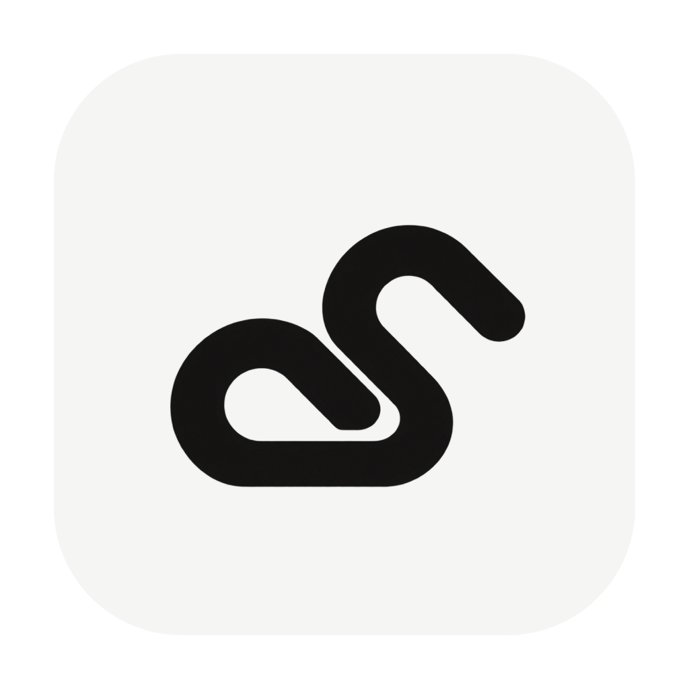

**A quiet agent for your Mac.**

Select text, capture your screen, or press **⌘ ⇧ Space** to start a conversation. Atd brings your models, tools, and local context into a small desktop panel—for everyday work, coding tasks, and apps of your own.

**macOS 15+ · Apple silicon and Intel**

 

[Website](https://atd.best) · GitHub download mirror: [Apple silicon](https://github.com/JUNERDD/Atd/releases/latest/download/Atd-arm64.dmg), [Intel](https://github.com/JUNERDD/Atd/releases/latest/download/Atd-x64.dmg) · [Release notes](https://github.com/JUNERDD/Atd/releases/latest) · [Interface previews](#interface-previews) · [Report an issue](https://github.com/JUNERDD/Atd/issues)

[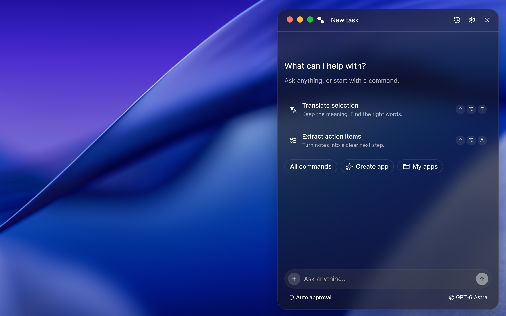](.github/readme/main-panel.jpg)

_Interface preview of the main panel._

## Get started

1. Download the latest DMG for your Mac — [Apple silicon](https://downloads.atd.best/latest/Atd-arm64.dmg) (saved as `Atd-<version>-arm64.dmg`) or [Intel](https://downloads.atd.best/latest/Atd-x64.dmg) (saved as `Atd-<version>-x64.dmg`); both need macOS 15 or later. Open it and drag **Atd** to **Applications**.
2. Open **Atd**. If macOS blocks it, follow the first-launch instructions in the warning above.
3. Open **Settings → Models**, add a provider connection, and choose your default provider and model. Connect with a supported account sign-in, API key, or local endpoint.
4. Press **⌘ ⇧ Space** to open the panel. Ask a question, attach a file, or start from selected text or a screenshot.

The selection toolbar asks for Accessibility access; screen capture asks for Screen Recording access. Grant these in macOS when you use those features.

Atd includes what it needs to run; you do not need to install Node.js. If a task needs an external tool, that tool must be available on your Mac.

### Shortcuts

| Action                 | Default shortcut |
| ---------------------- | ---------------- |
| Show or hide the panel | ⌘ ⇧ Space        |
| Take a screenshot      | ⌘ ⇧ 2            |
| New conversation       | ⌘ N              |
| Open settings          | ⌘ ,              |
| Send a message         | Enter            |
| Insert a new line      | Shift + Enter    |

Change these in **Settings → General**. The menu bar icon is another way to open the panel.

## What you can do

- **Bring the right context.** Use selected text, annotated screenshots, attachments, `@` file mentions, or drag files onto the Mini Panel.
- **Follow the work.** Streamed conversations show tool activity, file diffs, terminal output, web results, todo lists, and subagent activity. Continue a task with a follow-up, or stop an active run.
- **Use your models.** Connect cloud, local, and custom providers. Each connection has its own credentials and default model; existing tasks retain their model selection.
- **Make work reusable.** Save commands with parameters and shortcuts. Add skills, subagents, and MCP servers individually or through [supported plugin bundles](packages/plugin-kit/README.md).
- **Answer in place.** Run a command from the selection toolbar or its shortcut: tap to use the options you picked last, or hold to choose them. Its answer can replace the selected text, go in after it or at the cursor, be copied, or open in a conversation.
- **Build personal apps.** Describe a small tool, create it in a conversation, and open it from **My apps**. Apps can have an independent window, their own backend, and desktop widgets; return to the task to refine them.
- **Work across websites and apps.** Let a task request access to the websites and Mac apps it needs. Manage that access, browser environments, and computer-use controls in **Settings → Computer use**.
- **Run work automatically.** Schedule prompts or saved commands, react to folder changes, run when your Mac is idle, or chain work after another automation. Inspect status and run history, and pause automations from settings.
- **Keep control.** Set permissions per task, manage the shell allowlist, review stored memories, and pause memory learning.

Automations run while Atd is running. Unattended tasks decline actions that require approval instead of waiting for a response. Missed schedules can run once on return or be skipped. New installations include an editable **Consolidate memory** automation that runs at most once a day after two hours of Mac inactivity.

### Computer use

Ask Atd to work in a website or Mac app from a conversation. It requests access to the apps and sites the task needs. Open **Settings → Computer use** to review saved access, add a website or app yourself, and grant the macOS app-control and Screen Recording permissions.

For websites, install the optional browser engine from **Engines**, then choose **Add browser environment**. Sign in to the separate Chrome profile Atd opens and choose which sites it may use. Mac app control is included with Atd; choose **Add application** to make an app available.

Atd works in the background where the website or app supports it. In a task you start, a step that needs the foreground can briefly bring a Mac app forward, send clicks or keys without moving your pointer, and then return to the app you were using. Computer actions in automations need separate authorization and apps or websites checked for automation use.

Use **Stop all** in Computer use settings to stop computer actions across tasks and automations. Disconnecting a website or app revokes its saved access; browser sign-in data is kept.

## Interface previews

These previews are cropped from **1440 × 900** interface scenes in the UI designs and exported at 2×; they are not captures of the running app. Together with the main panel above, they show ten interfaces. Click an image to open it at full size.

### In place

<table>
  <tr>
    <th width="50%">Selection toolbar</th>
    <th width="50%">Write-back</th>
  </tr>
  <tr>
    <td width="50%"><a href=".github/readme/selection-toolbar.jpg">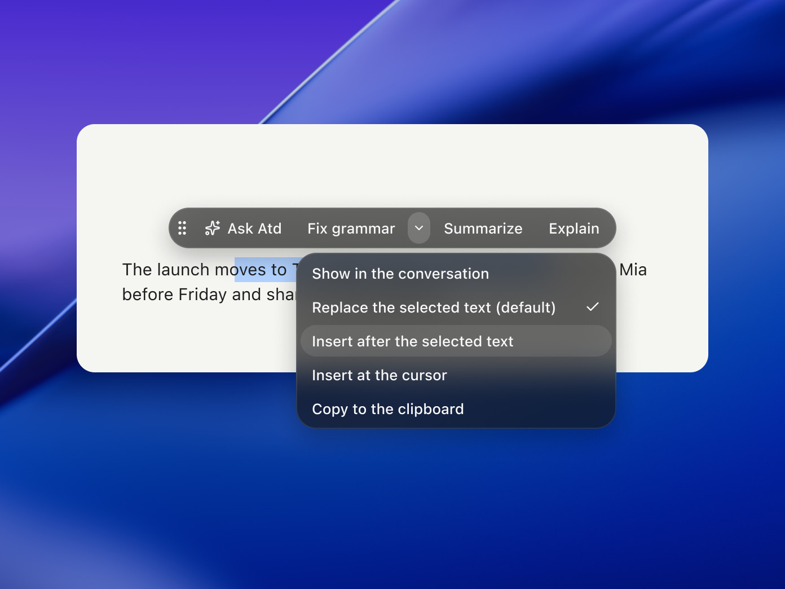</a></td>
    <td width="50%"><a href=".github/readme/write-back.jpg">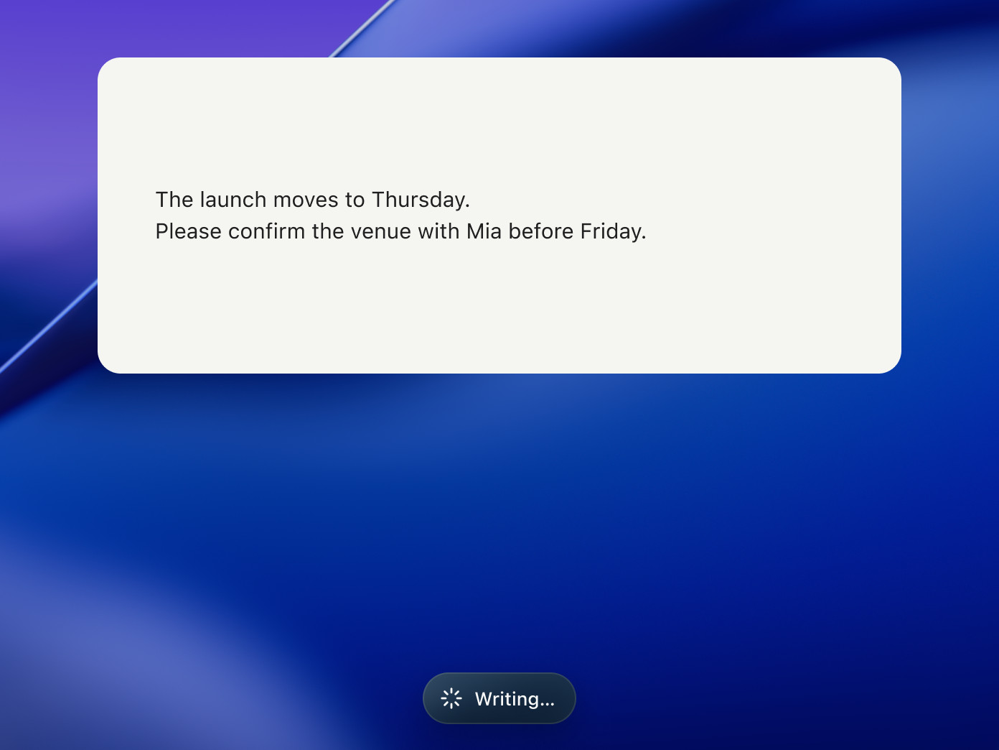</a></td>
  </tr>
  <tr>
    <td>Ask or run a command from a text selection, and choose where its answer goes.</td>
    <td>Review and refine the answer, then replace the selection or insert it after the original.</td>
  </tr>
</table>

[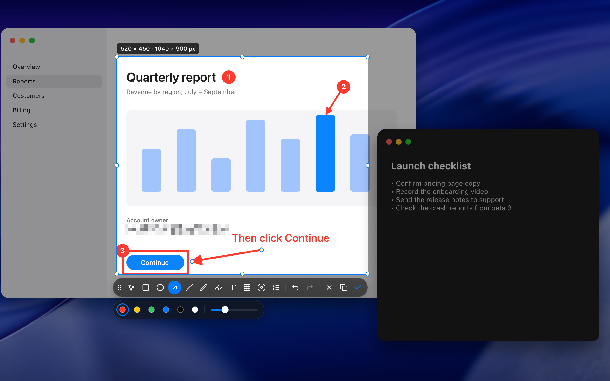](.github/readme/screenshot.jpg)

_Screenshot tool: capture an area and mark the details that matter._

### Panel and conversation

<table>
  <tr>
    <th width="50%">Conversation</th>
    <th width="50%">Mini Panel</th>
  </tr>
  <tr>
    <td width="50%"><a href=".github/readme/chat.jpg">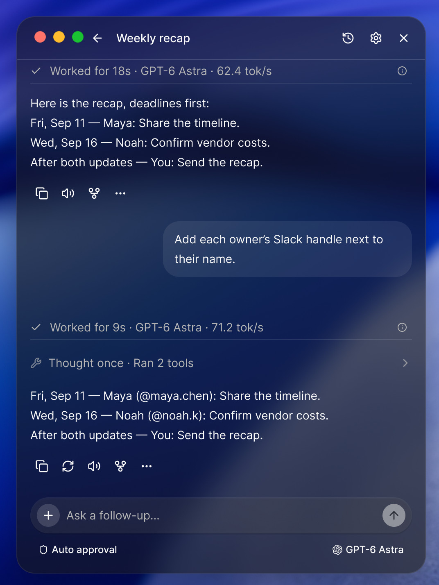</a></td>
    <td width="50%"><a href=".github/readme/mini-panel.jpg">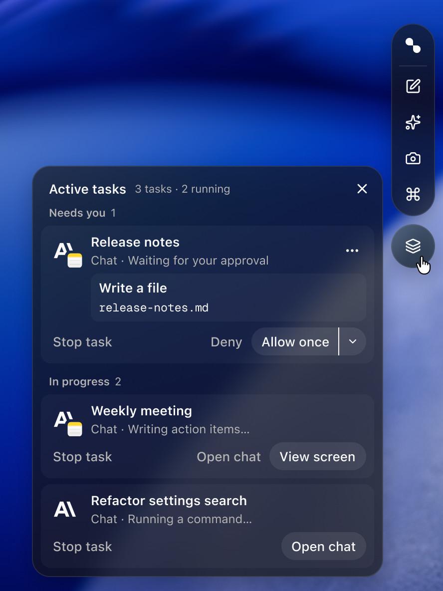</a></td>
  </tr>
  <tr>
    <td>Read the result and keep working in the same task.</td>
    <td>Follow running tasks and answer approvals from the edge of the screen.</td>
  </tr>
</table>

### Apps and connections

[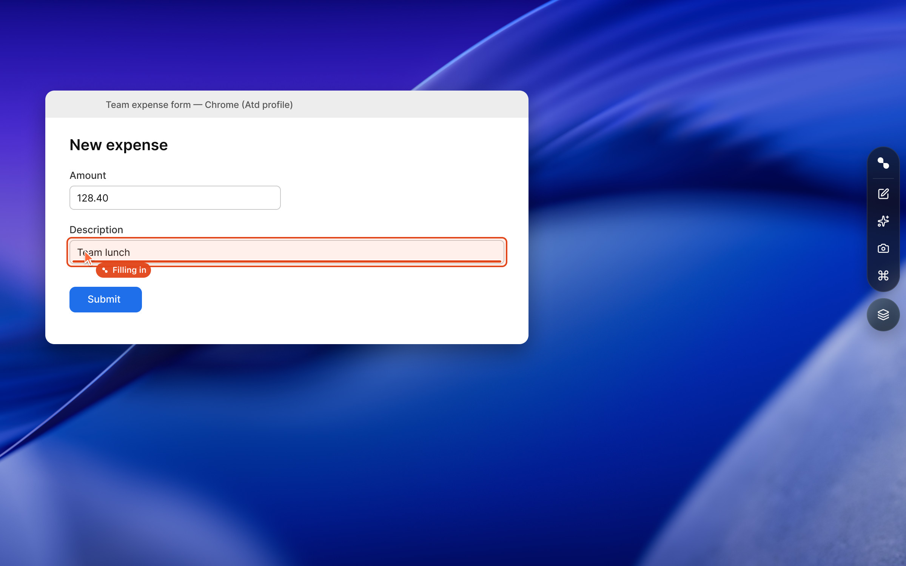](.github/readme/computer-use.jpg)

_Computer use: with your permission, Atd works websites and apps with a pointer of its own._

[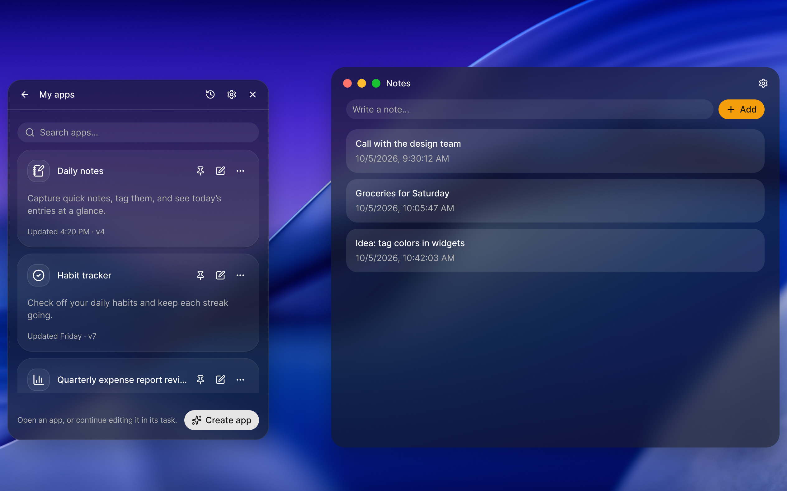](.github/readme/apps.jpg)

_My apps: turn an idea into an app you can open again._

[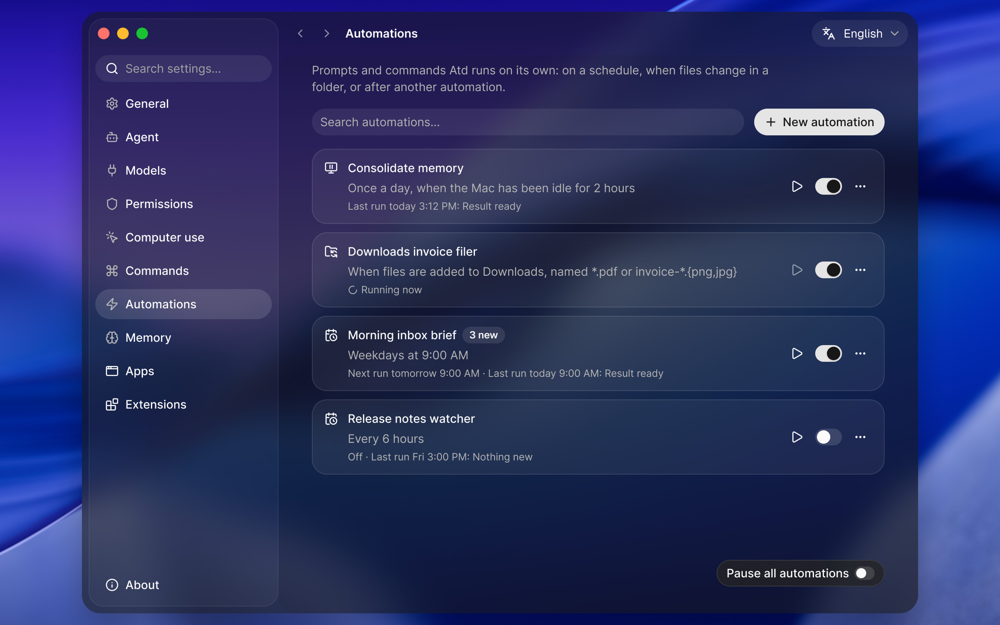](.github/readme/automations.jpg)

_Automations: scheduled tasks, folder workflows, and idle-time memory consolidation, with run status and a shared pause control._

[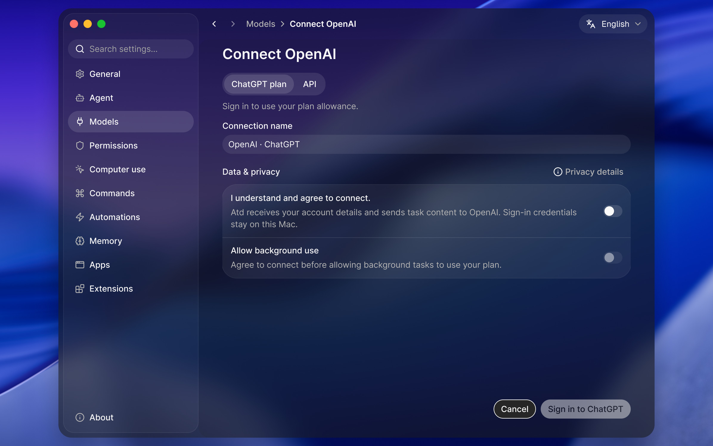](.github/readme/settings.jpg)

_Models and settings: connect a ChatGPT plan or API credentials, after agreeing to what the connection shares._

## Data and permissions

- **Local storage.** The installed app stores task history, settings, and memories in `~/Library/Application Support/AgentService`. Personal skills and agents live in `~/.atd` by default. Browser environments keep their sign-in data in separate profiles on your Mac.
- **Model and tool access.** Requests go to the model providers you configure. Tools and MCP servers can access the files or external services allowed by their configuration and the task's permissions.
- **Credentials.** Provider and MCP credentials are stored in your Mac’s keychain.
- **Approval controls.** Each task can use Manual approval, Auto approval, or Always allow; new installations start on Auto approval, which still asks when an action looks risky. Settings also owns the shell allowlist and memory-learning controls.
- **Lifecycle and logs.** Atd starts its local agent service when you open the app and stops it when you quit. If you need logs to troubleshoot a problem, choose **Show Service Logs** from the menu bar menu.

## Contributing

Read the [contributor guidelines](AGENTS.md) before making changes, and submit a pull request targeting `main`. Include reproduction steps and the expected result when [reporting an issue](https://github.com/JUNERDD/Atd/issues).

## License

Atd is released under the [MIT License](LICENSE). Code adapted from other projects keeps its own license: the [AI Elements](packages/ui/src/components/ai-elements/LICENSE) components (Apache-2.0), the memory engine's files from [pi-hermes-memory](licenses/pi-hermes-memory-LICENSE) (MIT), and the background computer-use driver (`apps/macos/Sources/AIComputerDriver`), written in Swift after recipes from [open-computer-use](licenses/open-computer-use-LICENSE), [yabai](licenses/yabai-LICENSE), [Peekaboo](licenses/peekaboo-LICENSE) and [Cua Driver](licenses/cua-driver-LICENSE) (all MIT). The PDF character maps in `apps/agent-service/vendor/pdfjs-cmaps`, taken from pdf.js, keep Adobe's [BSD-3-Clause license](apps/agent-service/vendor/pdfjs-cmaps/LICENSE).

The license covers the code, not the Atd name and logo, nor the logos of other companies and services in `packages/ui/src/assets/brands`, which remain their owners' trademarks.
