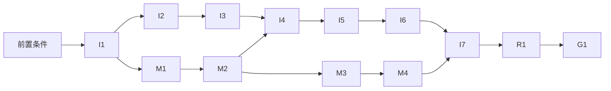

# macOS 15 与 Intel 联合适配计划

Status: In progress — 目标版本 0.9.0；I1–I6、M1–M4 的代码已在 `release/0.9.0` 完成并通过本地检查（见[实施进度](#实施进度)），等待 PR CI、需另行授权的 workflow 运行与预发布演练，以及 P2–P5 验收机器
Created: 2026-10-11
Revised: 2026-10-13（第八次修订：明确兼容代码的封装方式；第七次修订按 0.8.1 之后的代码校正事实与引用。两次都不改变范围与验收，见 [Review Outcome](#review-outcome)）
Approval: 用户已于 2026-10-13 授权实施（P6）；各项对外动作仍按[授权模型](#授权模型)另行授权

## Summary

在 0.8.x 之后的 **0.9.0** 中，同一轮完成 Intel 原生兼容与 macOS 15.0 适配。优先保证 Intel + macOS 15 的实际可用性，同时保留 Apple silicon 和 macOS 26 的现有功能。

交付包括：

- x64/arm64 构建与完整的原生依赖；
- 旧系统的材质与截图接口兼容；
- WebKit 18 能力基线；
- DMG、下载镜像和 Sparkle 更新。

全部相关项合并验收后才算完成，不能把仅支持 macOS 26 的 Intel 构建作为本计划的交付结果。

调研结论：联合适配可行。

- Intel 的主要障碍是构建、原生依赖（含 x64 产物缺少签名）与分发链路中的 arm64 限制。
- macOS 15 需要为 macOS 26 专用的材质和截图 API 提供兼容路径，并处理旧 WebKit 的 CSS 与 JS API 差异。
- 最低系统已由用户明确为 15，不扩展到 13/14，也不因此裁减生成应用、Widget、截图、命令岛或 MiniPanel 功能。15 使用其可用材质，26 保留现有效果。

Intel 交付门槛是 macOS 15 真机上的完整 Release 安装、核心功能和自动更新通过。x86_64 交叉编译、Rosetta 运行或单独在 macOS 26 运行，均不能替代该证据。

已有证据与边界：

- **调研阶段：** 在隔离副本中完成了 x86_64、macOS 26 的 Swift 模块编译，对象文件为 x86_64。这没有验证完整的 Release 应用、安装和更新。
- **评审阶段的 15.0 编译：** 在隔离副本中把 `Package.swift` 降到 `.macOS(.v15)`，用 Xcode 26.3 / Swift 6.2.4 编译：
  - AICore、AIRelay、AIWidgetModel、AIWidgetRender 及其测试在 15.0 编译通过。
  - AIShell 第一层报错为 **8 个文件、14 处**（`NSGlassEffectView`、`GlassEffectContainer`、`glassEffect`、`glassEffectTransition`、`captureScreenshot`）。
  - 把这些类型标为仅 26 可用后，对全部 172 个 AIShell 文件做整体类型检查，正好得到 **17 个文件、30 处**错误。它们全部来自被标注类型的消费者，没有第三层 Apple API 问题。这份清单是取证结果，不是迁移清单（见 M1）。
- **第七次修订的复核编译（2026-10-13，v0.8.1 之后的 `main`）：** 同样在隔离副本中降到 `.macOS(.v15)`，用 Xcode 26.3 / Swift 6.2.4：
  - AICore、AIRelay、AIWidgetModel、AIWidgetRender 及 AICoreTests、AIRelayTests 通过；Widget 扩展以 `-target arm64-apple-macos15.0` 零错误。
  - AIShell 现有 190 个文件，第一层为 **9 个文件、16 处**。多出的是共享玻璃所有者 `Windows/GlassSurface.swift`（4 处），`Island/IslandAnswerScroll.swift` 也已在第一层。
  - 把 9 个所有者类型标为仅 26 可用后，第二层为 **22 个文件、39 处**，仍全部来自被标注类型的消费者，没有第三层 Apple API 问题。计数受标注方式影响（例如整体标注 `IslandFadingScroll` 多出 3 处，而计划采用的无操作扩展不会产生它们），M1 开工清点仍以当时的代码为准。
  - 未发现其他 26 专用 API：没有 `glassEffectID`/`Union`、`.glass` 按钮样式、`backgroundExtensionEffect`、`ConcentricRectangle`、`LayoutRegion`、FoundationModels 或 SwiftUI `WebPage`，也没有已有的 `@available(macOS 26` 标注。
  - Widget 扩展以 `-target arm64-apple-macos15.0` 单独类型检查零错误；AIShellTests 未使用仅 26 可用的 API。
- **评审阶段的其他验证：** 在隔离副本中确认了三点：
  - Sparkle 的版本比较会忽略 `-` 之后的内容。
  - XcodeGen 构建设置加 `xcodebuild` 覆盖，能正确产生 feed 地址。
  - 降低 lib 后，desktop、ui、app-kit 的现有代码类型检查结果不变。
- **现有验证环境：** Apple silicon、macOS 26，尚无 Intel 或 macOS 15 的运行结果。

## Clarifying Questions

- [x] **最低系统到底是多少？** 用户在机型/系统范围及功能取舍两项询问中均明确回复 macOS 15；本计划以 15.0 为最低版本，保留现有功能。
- [x] **两项适配是否合并？** 用户明确要求"在 plan 中 15 和 intel 一起做了"；两项纳入同一实施范围、同一版本和同一交付验收，不拆成前后发布阶段。
- [x] **哪个验收优先？** 保留用户"保证 intel 兼容优先"的要求。在依赖图允许的范围内，Intel 是 CI 打包演练、产物模式与手工验收的第一目标，再完成 Apple silicon 与 macOS 26 回归。
- [x] **随哪个版本交付？** 用户选 B：0.8.0 先按现状发布，本适配进 0.9.0。`create-app` 产品技能升到 version 3；更新验证以最新已发布的 0.8.x 为 arm64 基线。
- [x] **本轮授权范围？** 编写并按评审修订可编辑计划；不修改实现文件，不运行任何 workflow，不使用任何外部资源。评审中的隔离副本编译只用于取证，不改仓库。
- [x] **分发方式如何选择？** 采用 arm64、x64 两套原生构建和 DMG，保留所有现有 arm64 下载及更新地址。暂不制作包含两套 Node 和原生模块的 Universal 应用。
- [x] **系统与工具链如何选择？** 两个架构统一最低 macOS 15.0；保留项目的 Swift 6.2、Xcode 26 与现有 Node/Rust 版本。编译宿主使用新系统，不等于应用只能运行在新系统；macOS 15 上的运行证据由 macOS 15 runner 和真机提供。
- [x] **"保证 Intel 兼容"如何验收？** 必须在真实 Intel + macOS 15 环境通过完整 Release 安装、核心功能及升级链路。缺少该环境时，不得把联合交付项标记完成。

最低系统、联合交付、Intel 优先级与目标版本均已确认。评审发现的其余问题都有仓库证据或常规默认可决。以下四项按默认处理：

- 中断演练使用独立的预发布 bucket；
- 除官网分支（见 I6、G1）外，全部改动以单个 PR 合入；
- 分支命名为 `release/0.9.0`；
- 正式发布路径在 R1 前只做"建草稿后删除"的彩排，发布与 `--latest` 两步作为已接受的剩余风险（见 Risks 与 R1 的中止条件）。

### 实施前置条件

以下条件不是产品问题，但未满足时，下表列出的工作不能开始或不能验收：

- [x] **P1：0.8.0 已发布。** `v0.8.0` 与补丁 `v0.8.1` 均已发布（arm64 feed）。`release/0.9.0` 已于 2026-10-13 从 v0.8.1 之后的 `main`（657143c5）切出；当前 0.8.x 基线为 0.8.1。
- [ ] **P2：Intel + macOS 15 验收机已落实。** 专用机器或专用 macOS 账户（见 I7 的隔离要求）；机型、负责人与可用日期待定。这是 I7 的硬门槛。
- [ ] **P3：Apple silicon 验收机已落实。** 一台专用的 macOS 26 机器，以及一台专用的 macOS 15.x 机器（真机优先），用于 arm64 回归、0.8.x → RC 升级与 Rosetta 回流。
- [ ] **P4：macOS 15.0 环境与 Sequoia + Safari 26 环境已落实。** 15.0 环境可以是 Apple silicon 虚拟机，用于 API 与 WebKit 18.0 基线；另需一台可以安装 Safari 26 的 Sequoia（真机或虚拟机）。
- [ ] **P5：预发布镜像资源已落实。** 由用户提供：
  - 一个与生产隔离、可公开读取（r2.dev 或自定义域名）的 R2 bucket。镜像校验会经 `--base-url` 用 HTTP 回读，并检查缓存头与 Range 响应。
  - 只能访问该 bucket 的演练凭据。
- [x] **P6：用户已授权实施。** 用户于 2026-10-13 指示执行本计划；范围见[授权模型](#授权模型)。

| 前置条件 | 阻塞的工作                                                                                                                                       |
| -------- | ------------------------------------------------------------------------------------------------------------------------------------------------ |
| P1       | 切出 `release/0.9.0`（I1 起的全部工作）；M4 的指纹                                                                                               |
| P2       | I7 第 1 项与 Intel 原生材质截图；R1 第 4 步的 x64 安装冒烟；G1 的 Intel 安装核对                                                                 |
| P3       | M1 开工前的基线截图（macOS 26 机器）；M2 的 15 验证构建与技术验证、M4 的 Sequoia 设计变体（macOS 15.x 机器）；I7 第 2–3 项；G1 的 arm64 升级核对 |
| P4       | M2 的 15 验证构建在 15.0 上的运行；M3 验收；I7 第 4 项                                                                                           |
| P5       | I5 验收                                                                                                                                          |
| P6       | 全部实施工作                                                                                                                                     |

### 验收机器上的操作

- P2–P4 机器上的操作由用户执行，包括安装、授予录屏与辅助功能等 TCC 权限、按快捷键、走提供商与 Keychain 流程、截取系统合成的窗口画面。授予 TCC 权限属于系统安全设置，agent 不代为操作。
- agent 负责为每一步准备逐项检查清单与所需构建，并整理用户回传的证据：机型、CPU、OS、WebKit 版本、构建版本号、制品摘要、结果与截图。
- 截图与记录存放在 gitignored 的 `tmp/`；只有总结性的验收结论写进 PR 描述，且其中不含个人路径或私有信息。
- 防止意外自动升级：`project.yml` 开启了 `SUEnableAutomaticChecks`、`SUAutomaticallyUpdate`，并且每小时检查一次。在验收机器上运行 15 验证构建或任何 RC 之前，先用 `defaults write com.junerdd.ai SUFeedURL` 指向本地 feed 或一个无效地址，用完后用 `defaults delete` 删除。否则新发布的 0.8.x 补丁（要求 macOS 26）可能被静默装到 15 的机器上。
- 启动本地 HTTP 服务（本地 feed、DMG）前，先用 `lsof -nP -iTCP:<port> -sTCP:LISTEN` 确认端口空闲。
- 每轮验收结束后清理：删除临时的 `AI_AGENT_DATA_DIR`，`defaults delete com.junerdd.ai` 写入的键，必要时用 `tccutil reset` 重置该 bundle ID 的授权，让下一轮从干净状态开始。
- ad hoc 签名的构建每次重建都会丢失 TCC 授权（见 AGENTS）。需要反复截图的阶段，用户可以设置 `AI_CODE_SIGN_IDENTITY` 使用同一证书构建，以保留授权。

### 授权模型

- **实施授权：** 覆盖以下工作：
  - 在 `release/0.9.0` 和官网分支上修改代码与文档、推送分支、开 PR，以及 PR 自动触发的 CI；
  - 按项目规则，把 M4 的设计变体与 I6 的官网下载区同步到 cloud Figma。官网下载区同步到项目 Figma 的 Website 页面（`docs/design-source.md` 记录了该页面的既有同步）。
- **对外动作：** 以下各项在执行前分别取得用户授权，实施授权不包含它们：
  1. **产物模式与草稿彩排：** 在分支上手动触发 release workflow 的 `artifacts` 或 `rehearsal` 模式。它们会使用签名证书和 Sparkle 私钥；`rehearsal` 还会在仓库里临时创建并删除一个草稿 release。一次授权可以覆盖本分支后续的这两类运行。
  2. **预发布 bucket 演练：** I5 的中断与回滚演练。
  3. **R1 正式发布：** 合并带 0.9.0 版本号的 PR。
  4. **G1 上线：** 通过 PR 合并官网分支，以及发布后的线上核对。

## File And Code References

以下路径均相对仓库根目录；符号和配置键优先于会随编辑变化的行号。

| 范围             | 文件及定位                                                                                                                                                                                                                                                                                                                                                                                                                                                                                                                                                                                                                                                                                                                                                                                                                                                                                                                                         | 已发现的约束                                                                                                                                                                                                                                                                                                                                                                                                                                                                                                                                                                                                                                                                                                                                                                    |
| ---------------- | -------------------------------------------------------------------------------------------------------------------------------------------------------------------------------------------------------------------------------------------------------------------------------------------------------------------------------------------------------------------------------------------------------------------------------------------------------------------------------------------------------------------------------------------------------------------------------------------------------------------------------------------------------------------------------------------------------------------------------------------------------------------------------------------------------------------------------------------------------------------------------------------------------------------------------------------------- | ------------------------------------------------------------------------------------------------------------------------------------------------------------------------------------------------------------------------------------------------------------------------------------------------------------------------------------------------------------------------------------------------------------------------------------------------------------------------------------------------------------------------------------------------------------------------------------------------------------------------------------------------------------------------------------------------------------------------------------------------------------------------------- |
| 版本与分支       | `apps/macos/package.json`、`apps/macos/project.yml` 的 `MARKETING_VERSION` 与 `CURRENT_PROJECT_VERSION: $(MARKETING_VERSION)`、`apps/desktop/package.json`、`apps/website/src/content/site.ts` 的 `version`                                                                                                                                                                                                                                                                                                                                                                                                                                                                                                                                                                                                                                                                                                                                        | 四处当前为 0.8.1，已发布（tag v0.8.0、v0.8.1）。既有发版提交（如 081ac491）同时改这四处；R1 时四处一起改为 0.9.0。`site.ts` 的 `version` 合并即随官网上线，0.9.0 同样运行于 Apple silicon + macOS 26，与官网现有文案不矛盾；按架构拆分的下载入口仍留在 I6 的官网分支                                                                                                                                                                                                                                                                                                                                                                                                                                                                                                            |
| 原生构建         | `apps/macos/Package.swift`（`swift-tools-version: 6.2`、`platforms`）；`apps/macos/project.yml` 的 `options.deploymentTarget.macOS`、`settings.base.MACOSX_DEPLOYMENT_TARGET`、`ARCHS`、`SUFeedURL`、`SUPublicEDKey`、`LSMinimumSystemVersion: $(MACOSX_DEPLOYMENT_TARGET)`；`apps/macos/package.json` 的 `build`/`build:release`                                                                                                                                                                                                                                                                                                                                                                                                                                                                                                                                                                                                                  | 部署目标有三处来源，值都是 26。`ARCHS: arm64`，两条构建命令都固定 `arch=arm64`。Xcode 宏的 `:default=` 运算符会在冒号处截断 URL。没有 warnings-as-errors，SwiftLint 只运行 `file_length`                                                                                                                                                                                                                                                                                                                                                                                                                                                                                                                                                                                        |
| 开发启动         | `apps/macos/scripts/dev-open.mjs`                                                                                                                                                                                                                                                                                                                                                                                                                                                                                                                                                                                                                                                                                                                                                                                                                                                                                                                  | 依赖固定的 `DerivedData/Build/Products/Debug/Atd.app` 路径                                                                                                                                                                                                                                                                                                                                                                                                                                                                                                                                                                                                                                                                                                                      |
| Rust 模块        | `packages/file-index/package.json`（napi targets、`files: ["*.node"]`）、`packages/file-index/scripts/build.mjs`、`packages/file-index/index.js`、`turbo.json`                                                                                                                                                                                                                                                                                                                                                                                                                                                                                                                                                                                                                                                                                                                                                                                     | 平台条件只放行 arm64。`build.mjs` 不传 `--target`，napi 按宿主构建。已提交的 `index.js` loader 依次尝试 universal、`./file-index.darwin-<arch>.node` 和包名。`packages/file-index/**` 不在任何 CI 路径过滤中                                                                                                                                                                                                                                                                                                                                                                                                                                                                                                                                                                    |
| 服务打包         | `apps/macos/scripts/prepare-service-pack.mjs`：Node 下载、file-index 必需项检查、`pruneStore`、`checkNativeSignatures`、`checkAppToolchain`、`pnpm deploy --prod`                                                                                                                                                                                                                                                                                                                                                                                                                                                                                                                                                                                                                                                                                                                                                                                  | Node 下载已按宿主架构。file-index 检查仅 arm64。签名扫描跳过不含宿主架构的 Mach-O。staging 路径固定在 `tmp/t7-*`，会临时改写并恢复 lockfile。检查函数以 Node 路径、包根和目录为参数，可拆出单独运行。`checkAppToolchain` 只写 `mkdtemp`，不需要网络。`bundle` 脚本只产出 `tmp/t7-node` 与 `tmp/t7-agent-service-pack`，不生成应用。脚本现有 533 行，已超过 350 行上限                                                                                                                                                                                                                                                                                                                                                                                                           |
| 应用内服务包     | `project.yml` 的 Release 嵌入阶段（从 `tmp/t7-node`、`tmp/t7-agent-service-pack` rsync）                                                                                                                                                                                                                                                                                                                                                                                                                                                                                                                                                                                                                                                                                                                                                                                                                                                           | 服务包位于 `Contents/Resources/agent-service`，Node 位于 `Contents/Resources/node/bin/node`，pnpm 符号链接为相对路径。Xcode 用发布身份签名应用、不加 `--deep`，所以 Resources 里的 Mach-O 保留各自的签名                                                                                                                                                                                                                                                                                                                                                                                                                                                                                                                                                                        |
| 原生依赖         | 见下方[原生依赖清单](#原生依赖清单)                                                                                                                                                                                                                                                                                                                                                                                                                                                                                                                                                                                                                                                                                                                                                                                                                                                                                                                | lockfile 均有 darwin-x64 变体。pnpm 未设置 `supportedArchitectures`，按宿主架构安装，只适用于原生 runner。x64 产物多数没有签名                                                                                                                                                                                                                                                                                                                                                                                                                                                                                                                                                                                                                                                  |
| 发布             | `.github/workflows/release.yml`                                                                                                                                                                                                                                                                                                                                                                                                                                                                                                                                                                                                                                                                                                                                                                                                                                                                                                                    | 触发方式：`main` 上的版本号变化，或无输入的 `workflow_dispatch`（在 `main` 上即表示发布）。`version` job 只允许 `main`，已有 tag 时跳过。`concurrency: group: release` 由所有运行共享：同一并发组最多保留一个排队中的运行，新排队的会挤掉旧的。`gh release create … --target "$GITHUB_SHA"` 会直接发布，没有草稿。发布说明写死 "Apple Silicon (arm64) build for macOS 26 or later"。appcast heredoc 没有 `minimumSystemVersion`，`sparkle:shortVersionString` 写的是 `$VERSION`。构建后校验 `CFBundleShortVersionString` 与 `CFBundleVersion` 都等于 `$VERSION`。Sparkle 的 `sign_update` 是 macOS 二进制；它的 `--verify` 需要单独传入签名，从私钥（`--ed-key-file`）推导公钥，并且不检查 `length`。同一个 tag 名可以对应多个草稿。`mirror` job 通过 `workflow_call` 调用      |
| CI               | `.github/workflows/ci.yml`                                                                                                                                                                                                                                                                                                                                                                                                                                                                                                                                                                                                                                                                                                                                                                                                                                                                                                                         | 只在 `push: main` 和 `pull_request` 触发，没有 `workflow_dispatch`（`workflow_dispatch` 要求默认分支上的 workflow 文件已声明该触发）。Linux 跑 `pnpm check`，`macos-26` 跑 `check:swift`/`check:rust` 并切换到 `/Applications/Xcode_26.3.app`。不构建服务包。`macOS desktop smoke test` 是 ruleset 要求的汇总检查。`macos-15` 镜像默认 Xcode 16.4 / Swift 6.1，另装有 26.0.1–26.3                                                                                                                                                                                                                                                                                                                                                                                               |
| 镜像             | `ops/release-downloads/mirror.mjs` 及其 README；`.github/workflows/mirror-release.yml`                                                                                                                                                                                                                                                                                                                                                                                                                                                                                                                                                                                                                                                                                                                                                                                                                                                             | 写死 bucket `atd-releases` 与 base `https://downloads.atd.best`。只读 `gh api releases/latest`（不含草稿与 prerelease），只接受 `vX.Y.Z` 格式的 tag。要求 release 资产中有 `appcast.xml`，且其中的 enclosure 是 GitHub 地址。`asset`、`file`、`sha256`、`disposition` 是模块级单架构变量。清理正则只匹配 `Atd-<v>-arm64.dmg`；`pruneOldMirrors` 按修改时间排序后 `slice(2)`，不分架构。mirror workflow 支持在 `main` 上手动运行，参数为 `tag: latest`。仓库内只有它自己读写 `latest.json`。#59（1cc03af8）加入了有界退避重试：`verifyRequest` 回读校验（在回调中读取上述模块级变量）、共享的 `scripts/http-retry.mjs`、workflow 的 `AWS_RETRY_MODE`/`AWS_MAX_ATTEMPTS` 与 README 的重试说明；`mirror.mjs` 现有 323 行                                                           |
| 旧版 GitHub feed | `release.yml` 头部注释与镜像 README                                                                                                                                                                                                                                                                                                                                                                                                                                                                                                                                                                                                                                                                                                                                                                                                                                                                                                                | 0.4.0–0.7.9 的安装读取 GitHub `releases/latest/download/appcast.xml`；0.7.10 起读取镜像 feed                                                                                                                                                                                                                                                                                                                                                                                                                                                                                                                                                                                                                                                                                    |
| DMG              | `apps/macos/dmg/background.mjs`（readout 写死 `arm64`）、`dmg/package.mjs`、`dmg/build.py`（Finder 书签修复在 26 上调定）                                                                                                                                                                                                                                                                                                                                                                                                                                                                                                                                                                                                                                                                                                                                                                                                                          | DMG 卷名为 "Atd <v>"，含空格                                                                                                                                                                                                                                                                                                                                                                                                                                                                                                                                                                                                                                                                                                                                                    |
| 对外入口与文案   | `apps/website/src/content/site.ts`（单一 `downloadUrl`、`minMacOS`、`chip`）、`src/sections/download/`、`src/sections/nav/index.tsx`（按钮直链 DMG）、`apps/website/public/llms.txt`（"the arm64 dmg"）、`src/sections/download/copy.ts`（英文芯片取 `site.chip`，中文写死为"Apple 芯片"）、root README、`apps/website/README.md`。宣传片已随 657143c5 迁到独立的 atd-films 仓库，其规格文案不在本仓库范围内                                                                                                                                                                                                                                                                                                                                                                                                                                                                                                                                       | 官网从 `main` 经 Vercel 自动部署，合并即上线                                                                                                                                                                                                                                                                                                                                                                                                                                                                                                                                                                                                                                                                                                                                    |
| AppKit 材质      | `Windows/Screens.swift` 的 `GlassBackground`（`make(content:)` 返回 `NSView`）、`UnifiedTitleBar`；`Windows/OnboardingWindowController.swift`（`surface: NSGlassEffectView?`、`cornerRadius`、`alphaValue` 淡入）；`Capture/Annotation/AnnotationGlassBar.swift`；`Selection/SelectionToolbarMenu.swift`；`PermissionGuide/PermissionGuidePanel.swift`（`GlassBackground.material()`、`cornerRadius`、`contentView`）；`Windows/GlassSurface.swift`（`attach`、`shape`、`disableAdaptation` 接收 `NSGlassEffectView`，私有 `_adaptiveAppearance`，深色 80% 底填充）；`Windows/ActiveGlassPanel.swift`（私有 `_hasActiveAppearance`，MiniPanel、工具栏与命令岛窗口的基类）                                                                                                                                                                                                                                                                          | 直接暴露或实例化 macOS 26 的 `NSGlassEffectView`。`GlassSurface` 是浮层玻璃的共享所有者：`AnnotationGlassBar` 与 `SelectionToolbarMenu` 经它的 `attach`/`shape` 设置填充与形状，它的 SwiftUI 部分见下一行。PermissionGuide 用窗口阴影（`hasShadow = true`，玻璃是 content view）。其余无边框表面（GlassHUD、SelectionToolbarPanel、SelectionToolbarMenu、Onboarding、标注栏）都是 `hasShadow = false`，在透明边距内由玻璃视图自己画阴影。浮层多为 non-activating，几乎不成为 key window。工具栏入场用 `sublayerTransform` 弹簧动画。标注栏（`AnnotationToolbar`、`AnnotationStyleBar`）位于截图遮罩窗口内，叠在冻结截图与暗化层之上（`Capture/CaptureOverlayView.swift`）；Onboarding 的 `setSurface` 会改变 frame、圆角并做 alpha 淡入，`AnnotationGlassBar.layout()` 会改圆角 |
| SwiftUI 材质     | `MiniPanel/MiniPanelView.swift`、`MiniPanelGlassPieces.swift`、`MiniPanelGlassShape.swift`；`Island/IslandView.swift`、`Island/IslandAnswerScroll.swift`（`.scrollEdgeEffectHidden`，26 专用；`Island/` 已随 0.8.0 提交）；`Windows/GlassSurface.swift` 的 `glassSurface(in:animation:opacity:)` → `clippedGlass(in:)`（唯一调用 `glassEffect` 的位置，MiniPanelView、MiniPanelGlassPieces、IslandView 共用）                                                                                                                                                                                                                                                                                                                                                                                                                                                                                                                                      | `GlassEffectContainer`、`glassEffect`、`glassEffectTransition` 需要 macOS 26。命令岛由 `Selection/CommandProgressController.swift` 创建，是在用功能。两者共用 `MiniPanelGlassOutline`，形状逐帧变形。共享修饰器已存在于 `GlassSurface`；`GlassEffectContainer` 在修饰器之外直接包住 `MiniPanelView` 与 `IslandView`                                                                                                                                                                                                                                                                                                                                                                                                                                                             |
| 截图             | `Capture/DisplayFreezer.swift`；`Capabilities/ScreenshotTaker.swift`                                                                                                                                                                                                                                                                                                                                                                                                                                                                                                                                                                                                                                                                                                                                                                                                                                                                               | 使用 5 个 26 专用 API：`SCScreenshotConfiguration`、`.dynamicRange = .sdr`、`.displayIntent = .local`、`captureScreenshot(...)`、`output.sdrImage`。`sdrImage` 为 nil 时 `freeze` 返回 nil，调用方跳过该显示器（`continue`）                                                                                                                                                                                                                                                                                                                                                                                                                                                                                                                                                    |
| 更新             | `App/AppUpdater.swift`（已实现 `SPUUpdaterDelegate`）；Sparkle 2.10.0 的 `SPUUpdater.m`、`SUHost.m`、`SPUAppcastItemStateResolver.m`、`SUStandardVersionComparator.m`                                                                                                                                                                                                                                                                                                                                                                                                                                                                                                                                                                                                                                                                                                                                                                              | feed 优先级：delegate `feedURLStringForUpdater:` > user defaults `SUFeedURL`（Sparkle 明确支持用 `defaults write` 做测试重定向）> Info.plist。`SUPublicEDKey` 只读 Info.plist。非 HTTPS feed 只记警告。Rosetta 进程能通过 arm64 硬件条件。x86_64 进程会把 `minimumSystemVersion` ≥ 27.0 的条目视为仅 arm64。版本比较在 `-` 处截断，所以 `0.9.0-rc.1`、`0.9.0-rc.2`、`0.9.0` 被判为相同版本。Sparkle 不提供更低的版本。应用没有沙盒 entitlement，也没有 ATS 配置                                                                                                                                                                                                                                                                                                                 |
| WebKit 能力      | `Web/WebKitPrivate.swift`、`Web/WebViewHost.swift`、`UserApps/UserAppHost.swift`；`apps/macos/Tests/AIShellTests/WebKitPrivateTests.swift`                                                                                                                                                                                                                                                                                                                                                                                                                                                                                                                                                                                                                                                                                                                                                                                                         | 私有 setter 经 `responds(to:)` 探测。`systemAppearanceEnablesGlass` 无条件断言 `-apple-system-glass-material` 可用。测试辅助 `GlassProbe` 内部的 `#expect(WebKitPrivate.enableSystemAppearance(...))` 在 15 上可能先于用例断言失败。`swift test` 只在 `macos-26` 运行。`isInspectable` 只在 `#if DEBUG` 下打开（`WebViewHost.swift`、`UserAppHost.swift`）。旧系统上，Safari 更新可能把 WebKit 装在 `/System/Library/Frameworks` 以外                                                                                                                                                                                                                                                                                                                                           |
| 功能下限复核     | `UserApps/UserAppStorage.swift`；`Widgets/WidgetSyncController.swift`；`apps/macos/Widgets/Extension/`；`MiniPanel/MiniPanelControls.swift`；`AIWidgetRender/WidgetTreeView.swift`、`WidgetLauncherView.swift`、`WidgetMessageView.swift`（`AIWidgetRender` 也链接进 Widget 扩展）                                                                                                                                                                                                                                                                                                                                                                                                                                                                                                                                                                                                                                                                 | `WKWebsiteDataStore(forIdentifier:)` 要求 14。Widget 与 MiniPanel 滚动 API 恰为 15.0。生成 Widget 的 SF Symbols 名称经 `Image(systemName:)` 透传，共 4 处调用点（`WidgetTreeView.swift` 两处、`WidgetLauncherView.swift`、`WidgetMessageView.swift`）。名称无法解析时显示空白；服务端只校验 `^[a-z0-9.]+$`                                                                                                                                                                                                                                                                                                                                                                                                                                                                      |
| Web 构建与类型   | `apps/desktop/vite.config.ts`、`packages/app-kit/builder/build.mjs`（服务端 `target: 'node24'`）；`packages/typescript-config/react.json`（被 ui、app-kit、website、desktop 继承）；`apps/desktop/tsconfig.json`（自行覆盖 `lib`；`include` 为 `src`、`tests`、`*.ts`、`plugins`，即 Vite/Vitest 配置也受其 lib 约束）；`packages/ui/tsconfig.json`；`packages/app-kit/tsconfig.json`（包含 `src`、`runtime`、`builder`、`template/web/src`、`template/server`、`template/shared`、`types`）与 `tsconfig.build.json`（`lib: ES2025`）；`packages/app-kit/src/sdk/{client,server}`；`packages/app-kit/src/node/typecheck.ts`                                                                                                                                                                                                                                                                                                                        | 两个 Web 构建目标为 `safari26`。`lib: ES2025` 包含 WebKit 18.0 没有的 iterator、promise、float16、regexp、intl 部分；其中的 `ES2025.Collection`（Set 方法）Safari 17 已支持。仓库的 TypeScript 7.0.2 接受 `ES2025.Collection`。`typecheck.ts` 只有一个程序（`web/src`、`server`、`shared` 一起检查），只给提示、不阻止构建。web 模板的 `App.tsx` 用类型导入引用 `template/server/index.ts`，所以任何覆盖 web 模板的程序都会连带检查服务端模板与服务端 SDK。DOM 类型不分版本。desktop 以源码方式检查 `@atd/agent-contracts` 与 `@atd/agent-client`                                                                                                                                                                                                                               |
| Web 样式与输入   | `packages/ui/src/styles.css` 的 `surface-glass`；`packages/ui/src/components/textarea.tsx`；`apps/desktop/src/features/agent/command-input.tsx`（`overflow-hidden`、10 万字符上限）；`apps/desktop/src/features/service/extension-agent-form.tsx`（`rows={10} field-sizing-fixed resize-y`）；`apps/desktop/src/features/agent/transcript/message-editor.tsx`（`max-h-60`）；`apps/desktop/src/features/memory/memory-fields.tsx`（`rows={8}`）；`apps/desktop/src/features/automations/action-fields.tsx`（`rows={6}`）；`apps/desktop/src/components/composer.css`（`.composer-input .cm-editor .cm-scroller` 的 `scrollbar-width: none`）；`quick-panel.css`（已有 `::-webkit-scrollbar` 先例）；`Textarea` 的其他消费者：`packages/ui/src/components/input-group.tsx` 的 `InputGroupTextarea`（props 为 `React.ComponentProps<'textarea'>` 并透传给 `Textarea`）、`parameter-field.tsx`、`command-action-fields.tsx`、`extension-mcp-form.tsx` | `field-sizing` 到 Safari 26.2 才支持，26.0/26.1 上 `rows` 仍然生效。`scrollbar-width` 要到 18.2 才支持。`text-wrap: pretty`（26.0，7 处声明与 6 处 `text-pretty`，含 `alert.tsx` 的 `md:text-pretty`）在 15 上被忽略。jsdom 30.1.2 的 `CSS.supports('field-sizing','content')` 返回 true，测试走原生路径                                                                                                                                                                                                                                                                                                                                                                                                                                                                        |
| 已生成应用       | `apps/agent-service/src/apps/service.ts`、`lifecycle.ts`、`versions.ts`；`packages/app-kit/src/node/toolchain.ts`（由 `packages/app-kit/src/node/build.ts` 使用）；`product-skills/create-app/SKILL.md`、`references/sdk.md`（`symbol()`、列表行 `symbol?`）；`src/builtins/manifest.ts`、`builtins/fingerprint.ts`                                                                                                                                                                                                                                                                                                                                                                                                                                                                                                                                                                                                                                | 启动读取已有的不可变构建。`toolchain.ts` 从 `@atd/ui` 依赖闭包推导 `readRoots`。`create-app` 在 v0.7.12 为 version 1，在 v0.8.0 与 v0.8.1 为 version 2（两个 tag 之间该技能与 manifest 无差异，指纹相同）；`history` 目前只有 v0.7.0 的 version 1 指纹。按 manifest 规则，版本发布后才把其指纹写入 `history`。没有测试引用这些指纹，也没有包装 `fingerprintDir` 的脚本。`create-app/SKILL.md` 第 5 步要求把构建诊断当作 bug，在下一次构建中修复                                                                                                                                                                                                                                                                                                                                 |
| 仓库规则         | `AGENTS.md` 的 Commands And Local Runtime（arm64 Debug、`macos-26` 发布、arm64 dmg）、Native Shell And Design Boundaries（`NSGlassEffectView` 与 WebKit 系统玻璃作为唯一材质）、Validation（CI 在 macOS 26 运行 Swift 与 Rust 检查）                                                                                                                                                                                                                                                                                                                                                                                                                                                                                                                                                                                                                                                                                                               | 适配后这些描述不再成立，需随实现更新                                                                                                                                                                                                                                                                                                                                                                                                                                                                                                                                                                                                                                                                                                                                            |

### 原生依赖清单

| 原生二进制                                                                                                        | 进入位置                                                                          | x64 来源                                                                                                                                | x64 签名现状            | 现有检查                 |
| ----------------------------------------------------------------------------------------------------------------- | --------------------------------------------------------------------------------- | --------------------------------------------------------------------------------------------------------------------------------------- | ----------------------- | ------------------------ |
| `@atd/file-index`                                                                                                 | 服务包                                                                            | 本仓库 napi 原生构建                                                                                                                    | 预计未签名              | 仅 arm64 必需项检查      |
| `@napi-rs/keyring`                                                                                                | 服务包                                                                            | 可选依赖 darwin-x64                                                                                                                     | 预计未签名              | 仅签名扫描               |
| `@earendil-works/pi-tui` `native/darwin/prebuilds/darwin-{arm64,x64}/darwin-platform.node`                        | 服务包                                                                            | 包内自带预编译，不走可选依赖；另带 linux/win32 预编译（ELF/PE）；loader 按 `${platform}-${arch}` 拼路径，吞掉加载错误后返回 `undefined` | 已实测"完全没有签名"    | 仅签名扫描               |
| `esbuild`（`@esbuild/darwin-<arch>/bin/esbuild` 与 `esbuild/bin/esbuild`）                                        | 服务包，由 `@earendil-works/chord` 引入，`pnpm-workspace.yaml` 允许其 postinstall | 可选依赖 darwin-x64                                                                                                                     | 预计未签名（Go 二进制） | 仅签名扫描               |
| `@rolldown/binding`、`lightningcss`（两个版本）、`@tailwindcss/oxide`、`@typescript/typescript-darwin-*`（`tsc`） | 服务包（离线应用模板构建工具链）                                                  | 可选依赖 darwin-x64                                                                                                                     | 预计未签名              | `checkAppToolchain` 执行 |
| Node 24.21.0                                                                                                      | 服务包                                                                            | 官方 darwin-x64，最低 macOS 13.5                                                                                                        | 官方签名                | 下载按宿主架构           |
| Sparkle 2.10.0                                                                                                    | App                                                                               | 通用二进制，最低 macOS 12                                                                                                               | 已签名                  | 签名扫描                 |

链接器只给 arm64 产物自动加 ad hoc 签名，x86_64 产物没有。抽样的原生模块最低系统为 10.15–12.0，均低于 15.0。

上游依据：

- [Node 24.21.0 平台支持](https://github.com/nodejs/node/blob/v24.21.0/BUILDING.md#platform-list) 覆盖 darwin arm64/x64，最低 macOS 13.5。
- [Rust Darwin 支持](https://doc.rust-lang.org/rustc/platform-support/apple-darwin.html) 的默认最低版本为 x86_64 10.12、aarch64 11.0。

低版本范围已复核：

- macOS 15 可保留 [WebKit 独立持久数据存储](https://webkit.org/blog/14423/building-profiles-with-new-webkit-api/) 及现有 Widget 能力。
- Swift 运行时特性在 15.0 可用：`Mutex`/Synchronization、Vision `perform(on:)`、`@concurrent`，以及 `isolated deinit` 的回部署 shim。
- `UnifiedTitleBar` 只用 macOS 11+ 的 API。
- 进一步降低至 13/14 不纳入本计划。

## Implementation Decisions

### 版本与分支

- 0.8.0 已按现状发布，随后又发布了 0.8.1。`release/0.9.0` 已从 0.8.1 之后的 `main`（657143c5）切出，不跟踪远端 `main`；除官网分支外，全部改动通过一个 PR 合入。
- PR 的 head 以 `release/` 开头。I4 加入 Intel 打包演练与 `macos-15` 的 `swift test` 之后，它们会在 PR 上自动运行；在此之前，PR 只跑现有检查。
- 期间 `main` 上的 0.8.x 补丁照常走现有单架构流程，分支定期合并 `main`。文中的"0.8.x 基线"指 R1 时最新已发布的 0.8.x。
- R1 前最后一次合并 `main` 后，把四处版本号（见 [File And Code References](#file-and-code-references) 的"版本与分支"行）改为 0.9.0，合并 PR 即触发正式发布。

### 架构映射与 runner

使用统一映射区分生态中的架构名称。构建命令默认使用原生宿主架构，任何显式目标都必须与实际打包宿主一致。单独交叉编译只用于诊断，不作为可分发应用的构建方式。目标架构以应用主可执行文件为准，不以运行脚本的 `process.arch` 为准。

| Node / 制品标记 | Xcode / Mach-O | Rust target            | Release 原生构建 runner | macOS 15 校验 runner |
| --------------- | -------------- | ---------------------- | ----------------------- | -------------------- |
| `arm64`         | `arm64`        | `aarch64-apple-darwin` | `macos-26`              | `macos-15`           |
| `x64`           | `x86_64`       | `x86_64-apple-darwin`  | `macos-26-intel`        | `macos-15-intel`     |

runner 现状：

- **规格与镜像：** `macos-26-intel` 与 `macos-15-intel` 为 x64、4 CPU、14 GB。`macos-26`/`macos-26-intel`/`macos-15` 镜像都带 Xcode 26.3。`macos-15` 镜像为 15.7.x，默认 Xcode 16.4 与 Command Line Tools 16.4。
- **校验 job：** 用 CLT 提供的 `lipo`、`codesign`、`vtool` 和应用内的 Node，不需要 Xcode 26。
- **测试 job：** 运行 `swift test` 的 job 必须切到 Xcode 26.3。
- 依据：[runner 清单](https://docs.github.com/en/actions/reference/runners/github-hosted-runners)、[runner-images](https://github.com/actions/runner-images)。

两套构建：

- 使用同一个源码提交、应用版本、bundle ID、签名证书和 Sparkle 公钥。同一份 `RELEASE_SIGNING_P12` 得到相同的 designated requirement，隐私授权跨架构一致。
- 使用独立的 checkout 和依赖安装。

### 产物与地址

| 产物与地址                    | arm64：保持兼容                                                                               | x64：新增                         |
| ----------------------------- | --------------------------------------------------------------------------------------------- | --------------------------------- |
| 版本 DMG                      | `Atd-<version>-arm64.dmg`                                                                     | `Atd-<version>-x64.dmg`           |
| GitHub 稳定名称               | `Atd-arm64.dmg`                                                                               | `Atd-x64.dmg`                     |
| GitHub release 中的 feed 资产 | `appcast.xml`（始终是 arm64 feed，enclosure 为 GitHub 地址，供 0.4.0–0.7.9 旧安装与镜像读取） | `appcast-x64.xml`（没有旧版读者） |
| 镜像稳定路径                  | `/latest/Atd-arm64.dmg`                                                                       | `/latest/Atd-x64.dmg`             |
| 镜像 Sparkle feed             | `/appcast.xml`                                                                                | `/appcast-x64.xml`                |

### 更新分流

- **独立 feed：** Sparkle 的 `sparkle:hardwareRequirements`（2.9+）只接受 `arm64`，单一 feed 无法把 x64 条目排除在 Apple silicon 之外（[Sparkle 发布协议](https://sparkle-project.org/documentation/publishing/)）。
- **feed 构建设置：**
  - `project.yml` 的 `settings.base` 定义普通变量 `ATD_SPARKLE_FEED_URL` 与 `ATD_SPARKLE_ARM64_FEED_URL`，两者都是 `https://downloads.atd.best/appcast.xml`。
  - Info.plist 中 `SUFeedURL = $(ATD_SPARKLE_FEED_URL)`，`AtdArm64FeedURL = $(ATD_SPARKLE_ARM64_FEED_URL)`。
  - x64 构建由 `apps/macos/scripts/build.mjs` 通过 `xcodebuild` 参数，把 `ATD_SPARKLE_FEED_URL` 覆盖为 `https://downloads.atd.best/appcast-x64.xml`。
  - 不使用 `:default=` 运算符。`SUPublicEDKey` 保持字面量，两种架构相同。
- **Info.plist 期望值：** 由 `verify-app.mjs` 统一检查（见 I3），调用方按架构传入：
  - `SUFeedURL`：arm64 为 `…/appcast.xml`，x64 为 `…/appcast-x64.xml`；
  - `AtdArm64FeedURL`：两种架构都是 `…/appcast.xml`；
  - `SUPublicEDKey`：等于 `project.yml` 中的值。
- **feed 条目：**
  - arm64 feed 条目加 `<sparkle:hardwareRequirements>arm64</sparkle:hardwareRequirements>`。
  - 两个 feed 的条目都在 `<item>` 内声明三段式 `<sparkle:minimumSystemVersion>15.0.0</sparkle:minimumSystemVersion>`。
  - x64 feed 永远不声明 27.0.0 或更高。
  - 这些条目只在 R1 正式发布时写入公开 appcast。
- **Rosetta 回流：** `App/AppUpdater.swift` 增加 `feedURLString(for:)`。
  - 只有在 `sysctl.proc_translated == 1`、且 user defaults 中没有 `SUFeedURL` 时，才返回 arm64 feed 地址；其余情况返回 nil。
  - arm64 地址先读 user defaults 的 `AtdArm64FeedURL`，没有再读 Info.plist 的同名键；前者用于发布前的端到端测试。
  - 用 `os_log` 以 `.default` 级别、`privacy: .public` 记录最终选用的 feed 地址（与 `AIRelay/SchemeTaskTable.swift` 的写法一致；否则日志里只显示 `<private>`），只在地址变化时记录，作为验收证据。Sparkle 每次查 feed 都会调用这个 delegate，而 x64 进程会在更新时退出，`.info`/`.debug` 级别默认不落盘。
  - 这样误装 x64 的 Apple silicon 用户下次更新会回到原生构建，Sparkle 支持的 `defaults write` 测试重定向也不受影响。

### 产物模式与 RC 版本号

- **`mode` 输入：** `release.yml` 的 `workflow_dispatch` 增加 `mode` 输入，取值 `release`（默认）、`artifacts` 或 `rehearsal`。
  - **`version` job：** 在所有模式下都运行，是唯一判断模式的地方。被依赖的 job 跳过时，下游 job 也会跟着跳过（[`jobs.<id>.needs`](https://docs.github.com/en/actions/reference/workflows-and-actions/workflow-syntax#jobsjob_idneeds)），所以不能靠跳过它来区分模式。
    - mode 取 `inputs.mode || 'release'`。
    - `release` 模式在非 `main` 分支上直接 `exit 1`；在 `main` 上执行现有的版本号变化与 tag 检查。
    - `artifacts`/`rehearsal` 模式从输入取 `marketing_version`/`build_version`，没有输入时取 `project.yml` 的当前值；`build_version` 含 `-` 时报错。
    - 输出 `mode`、`marketing_version`、`build_version`、`build`（是否构建）和 `publish`（是否发布）。
    - 现有的全部 `needs.version.outputs.version`/`outputs.release` 引用逐处改为新输出：job 名、`VERSION` 环境变量、镜像 job 的 `with.tag` 改用 `marketing_version`；发布 job 的条件改用 `publish`；镜像 job 的条件改为 `needs.<发布 job>.result == 'success' && !contains(needs.version.outputs.marketing_version, '-')`。漏改的引用会读到空值，镜像会以 `tag: v` 运行并失败。
  - **下游 job 的条件：**
    - 构建 job 按 `needs.version.outputs.build == 'true'` 运行；
    - 发布与镜像 job 按 `publish == 'true'` 运行，只有 `main` 上的 `release` 模式或 push 才会为真；
    - 草稿 job 按 `publish == 'true' || mode == 'rehearsal'` 运行，其中的发布步骤只在 `publish == 'true'` 时执行，删除彩排草稿的步骤只在 `mode == 'rehearsal'` 时执行。
  - 并发组只让 `main` 上的 `release` 模式（含 push）进入 `publish` 组：`release-${{ github.ref == 'refs/heads/main' && (inputs.mode || 'release') == 'release' && 'publish' || github.ref }}`。在其他分支误跑 `release` 模式时，不会挤掉排队中的正式发布；产物与彩排运行按分支串行。
  - `release.yml` 已在默认分支声明 `workflow_dispatch`，所以可以在 `release/0.9.0` 上按分支版本的 workflow 文件和新输入运行。
- **feed 生成归属：** 两种架构的 appcast 生成与签名（现为 `release.yml` 中的 heredoc，可以拆成脚本）归 I4。`artifacts`、`rehearsal`、`release` 三种模式共用同一套生成步骤。
- **产物模式的输出：**
  - 构建并校验两种架构，产出签名 DMG。
  - 每个架构一份完整 appcast 文件：enclosure 为该版本的 GitHub release 地址形态，`length` 与 EdDSA 签名在 CI 内用生产 Sparkle 私钥生成，私钥不离开 CI。
  - 一份清单，记录版本、构建版本号、sha256 与大小。
  - 以上都作为 workflow artifact 上传；DMG 内的可执行权限不受 artifact 打包影响。
  - 从不创建 tag 或 release，不写 R2。
- **RC 版本号：** 产物模式接受两个输入：
  - `marketing_version`：覆盖 `MARKETING_VERSION`，用于显示，例如 `0.9.0-rc.3`。
  - `build_version`：覆盖 `CURRENT_PROJECT_VERSION`，必须不含 `-`，例如 `0.9.0rc.3`。它用于 `CFBundleVersion` 和 feed 的 `sparkle:version`。
  - 已有的构建后校验改为按键比较：`CFBundleShortVersionString` 等于 `marketing_version`，`CFBundleVersion` 等于 `build_version`。feed 的 `sparkle:shortVersionString` 写 `marketing_version`。
  - `xcodebuild` 参数对所有 target 生效，App 与 Widget 的 Info.plist 都引用 `$(CURRENT_PROJECT_VERSION)`，两者的构建号一致。
  - 评审已验证比较顺序为 `0.8.0 < 0.9.0rc.1 < … < 0.9.0rc.10 < 0.9.0`。
  - 非纯数字的 `CFBundleVersion` 只出现在不发布的 RC 中，正式版仍为 `0.9.0`。
- **本地更新测试：**
  1. 把 feed 中的 enclosure 改写为 `http://127.0.0.1:<port>/…`。用 IP 字面量，不用 `localhost`。签名只覆盖 DMG 内容，改写地址不影响验签。
  2. 本地提供 DMG 与 feed，再用 `defaults write com.junerdd.ai SUFeedURL`（或 `AtdArm64FeedURL`）指向它。
  3. 测试结束后删除这些键。

  应用没有沙盒和 ATS 限制，Sparkle 对非 HTTPS feed 只记警告。

- **草稿彩排（`rehearsal` 模式）：** 先完成 `artifacts` 模式的全部步骤，再在 `release/0.9.0` 上演练正式发布中除"发布"以外的步骤：
  - 用 `gh api -X POST repos/{owner}/{repo}/releases -F draft=true -f tag_name=v<marketing_version>-rehearsal.<run_id> -f target_commitish="$GITHUB_SHA"` 创建草稿，并从返回值直接取得 id（`gh release create` 只打印 URL）。
  - 上传全部资产，按 id 做发布前核对（见[发布、镜像与失败处理](#发布镜像与失败处理)）。
  - 在 `if: always()` 的步骤里按 id 删除该草稿，彩排失败时也不留下草稿。草稿没有 tag，只有协作者可见，不会被 `releases/latest` 或镜像读到；它的名字也不会与真实的 `v0.9.0` 冲突。
  - 发布（`draft=false`）与 `--latest` 两步不在彩排范围内，作为已接受的剩余风险，由 R1 的中止条件兜底。

### 发布、镜像与失败处理

- 服务数据协议、Keychain 标识、应用身份与用户应用版本历史保持兼容。
- **正式发布流程（`main`，`release` 模式）：**
  1. 两个构建 job 各自产出 DMG，作为 workflow artifact。
  2. `macos-15`/`macos-15-intel` 的校验 job 下载 artifact 并核对 sha256，只读挂载 DMG 到不含空格的挂载点，用 `ditto` 拷出应用，再用应用内 Node 运行 `verify-app.mjs`。
  3. 收集 job 运行在 macOS 上，持有 `SPARKLE_ED_PRIVATE_KEY` 与两个 DMG，并重复 `release.yml` 现有的、固定版本的 Sparkle 工具包下载，以取得 `sign_update`。它生成两个签名 feed，并逐个 enclosure 核对：
     - `length` 等于对应 DMG 的字节数；
     - `printf %s "$SPARKLE_ED_PRIVATE_KEY" | sign_update --verify --ed-key-file - <dmg> <edSignature>` 通过；
     - 用 `project.yml` 的 `SUPublicEDKey`，以及构建出的应用 Info.plist 中的 `SUPublicEDKey`，独立验签（Node 的 `crypto.verify(null, dmg, <由 32 字节原始公钥包装的 Ed25519 SPKI>, sig)`，不需要私钥）。`sign_update` 用的公钥是从私钥推导的，secret 一旦与 `SUPublicEDKey` 不匹配，只有这一步能发现。
  4. 用 `gh api --paginate repos/{owner}/{repo}/releases` 找出所有 `draft && tag_name == "v$VERSION"` 的遗留草稿，按 id 全部删除。然后用 `gh api -X POST repos/{owner}/{repo}/releases -F draft=true -f tag_name="v$VERSION" -f target_commitish="$GITHUB_SHA"` 创建草稿，从返回值取得 id，再上传全部资产。草稿没有 tag、没有读者，因此总是重建，不复用。
  5. 发布 job 显式 `needs` 两个校验 job 和收集 job，然后按记录的 id 核对草稿：
     - 每个资产的 `digest` 等于构建 artifact 的 sha256；`digest` 为空时下载后计算；
     - 版本号一致。
  6. 全部通过后，按 id 发布：`gh api -X PATCH repos/{owner}/{repo}/releases/$ID -F draft=false -f make_latest=true`。
     - `make_latest` 是字符串枚举，必须用 `-f`；`-F` 会发送布尔值。
     - 版本号带 `-` 的预发布改为发送 `-F prerelease=true`，并且不带 `make_latest`。
     - 发布后断言 `gh api repos/{owner}/{repo}/git/ref/tags/v$VERSION` 指向 `$GITHUB_SHA`。tag 在发布时按 `target_commitish` 创建。
  7. `mirror` job 的 `needs` 指向发布 job。
- **R2 多对象更新：** 没有事务保证。
  - 先验证并上传全部不可变产物。已存在且 sha256 相同的键视为已完成。
  - 再推进各架构入口。部分失败时允许短暂版本不同，但每个 feed 只能指向已验证的同架构 DMG，重试必须可恢复。
- **旧 release 与空 feed：**
  - 按架构校验时，接受只有 arm64 资产、feed 条目不含 `hardwareRequirements` 与 `minimumSystemVersion` 的旧 release（例如 0.8.x）。
  - 最新 release 缺少 x64 资产时，为 x64 写入一个没有条目的空 feed，同时删除 `/latest/Atd-x64.dmg` 和 `latest.json` 中的 x64 条目。这样回滚后不会继续提供已撤下的 x64 安装包。

### Web 能力基线

基线为 WebKit 18.0，即 macOS 15.0 的初始版本。

- **构建目标：** 降到 `safari18`，这只处理语法。
- **ECMAScript 内置 API：** 由 `lib: ["ES2024", "ES2025.Collection", "DOM", "DOM.Iterable"]` 在编译期约束，Set 方法保留，适用于在 WebKit 中运行的代码（见 M3）。它不覆盖 DOM 与 CSS API，后两者靠 feature detection、`@supports` 和真实页面验收。
- **接受的降级：**
  - `text-wrap: pretty` 在 15 上被忽略；
  - 26.0/26.1 上使用 `rows` 的 Textarea 改为按内容增高，与 26.2+ 的现有行为一致；
  - 15 上不复现液态玻璃（见 M1/M2）。

### 兼容代码的封装

兼容代码按能力封装，不建全局的版本开关或版本枚举。

- **判断能力，不判断版本号：** Swift 用 `#available`/`@available`，私有 API 用 `responds(to:)` 探测，Web 用 `@supports` 与 `CSS.supports`。不读取 `ProcessInfo.operatingSystemVersion` 来决定功能。Swift 只在 `#available` 的词法范围内放行新 API，包装成返回 `Bool` 的函数会失去编译器的可用性检查，这也是不建全局开关的原因。
- **有设计取舍的能力归所属类型：** 15 与 26 的表现不同、需要设计决定的能力，分支放在拥有它的类型内部：材质归 `NativeMaterialView` 与 `GlassSurface`（M1/M2），截图归 `DisplayFreezer`（M2），WebKit 私有设置归 `WebKitPrivate`，Web 输入控件归共享 `Textarea`（M3）。调用方拿到的是与版本无关的接口。
- **纯 API 补丁集中在 `Backport`：** 15 上只需"不做"或"直接返回内容"、不涉及设计的 SwiftUI 补丁，统一放在 `apps/macos/Sources/AIShell/Support/Backport.swift`（拟新增），以 `extension View { var backport: Backport<Self> }` 的命名空间调用，例如 `.backport.scrollEdgeEffectHidden()`。首批成员见 M2：`scrollEdgeEffectHidden`、`glassEffectTransition` 与 `GlassEffectContainer` 的包装。文件遵守 350 行上限；出现 AppKit 的纯补丁时同样放在这里。
- **标注删除时机：** `Backport` 的每个成员都标注 `@available(macOS, deprecated: 26, message: "…")`，消息写明对应的原生 API。最低系统提到 26 时，编译器会在每个调用点给出弃用警告。所属类型内的 `#available(macOS 26, *)` 不会被报为多余检查（实施时以 Swift 6.2.4 在 26 部署目标下实测），提升最低系统的改动需按 `#available(macOS 26` 检索后手动清理。弃用警告（项目未开启 warnings-as-errors），由提升最低系统的那次改动负责清理。分支在 M2 降低部署目标之前仍以 26 为目标，这段时间内这些警告属于预期，不加抑制。
- **两条路径都要验证：** 两个分支都由编译覆盖，`macos-26` 与 `macos-15` 上都运行 `swift test`（I4），Web 侧由 `lib` 约束与真实页面验收覆盖（M3）。

## Plan Todos

I 项负责架构与分发，M 项负责系统兼容，R1 是正式发布门槛，G1 是发布后的上线步骤。编号只区分工作内容；I1–I7 与 M1–M4 全部属于 0.9.0 的同一个交付里程碑。原 M5（macOS 15/26 兼容矩阵检查）已并入 I7。

### 架构与分发

- [ ] **I1：统一构建架构。**
  - 在 `apps/macos/scripts/build.mjs`（拟新增）集中处理：
    - Debug/Release 的原生架构映射与目标验证；
    - Xcode 参数；
    - x64 的 `ATD_SPARKLE_FEED_URL` 覆盖；
    - 产物模式的 `MARKETING_VERSION`/`CURRENT_PROJECT_VERSION` 覆盖。
  - 更新 `apps/macos/package.json` 与 `project.yml`：消除固定 arm64，加入[更新分流](#更新分流)中的 feed 构建设置。
  - 部署目标的降低不在本项，见 M2。保留现有开发启动路径。
  - 验收：
    - 同一入口在 arm64 宿主生成 arm64 应用，Info.plist 的两个 feed 键正确。
    - 显式目标与宿主不一致时明确失败。
    - x64 的参数映射可通过 dry-run 输出检查。
- [ ] **I2：打通 Rust/file-index 的 x64 构建。** 依赖 I1。
  - 扩展 napi targets 和 `build.mjs` 的平台条件，在原生宿主上构建。
  - 不改 `rust-toolchain.toml`（Intel 上 rustup 自带宿主 std）；不强制部署目标（rustc 默认值已低于 15.0）。
  - 用既有 napi 工具重新生成 loader 并确认无差异，不手改生成文件。
  - 预防性地对 `@atd/file-index#build` 关闭 Turbo 缓存。把 `packages/file-index/**` 纳入 `ci.yml` 中 macOS Swift/Rust job 与 I4 的 Intel 打包演练的路径过滤。
  - 非 darwin 宿主保持现有的跳过行为，Linux 上的 `pnpm check` 依赖它；只有 darwin arm64/x64 宿主构建失败或产物缺失时才报错，其他 darwin 架构明确失败。
  - 验收：arm64 本地构建与加载不回退；平台条件放行 x64；Linux 上的 `pnpm check` 不受影响。
- [ ] **I3：服务包的架构裁剪、补签与独立校验。** 依赖 I2。
  - **裁剪：** 在 `pruneStore` 之后按目标架构删除：
    - pi-tui 的 `native/darwin/prebuilds/darwin-<另一架构>`、`native/linux`、`native/win32`；
    - 另一架构的 `file-index.*.node`。
  - **补签：** 只对没有签名的目标架构 Mach-O 做 ad hoc 签名（`codesign --force -s -`）。签名前先复制文件，断开指向 pnpm store 的硬链接；已有签名的切片不重签。
  - **拆出校验脚本：** 把必需模块、实际加载、Mach-O 规则、Info.plist 期望值和 `checkAppToolchain` 抽到 `apps/macos/scripts/verify-app.mjs`（拟新增）。
    - `prepare-service-pack.mjs` 现有 533 行。拆分后它与新脚本都要回到 350 行以内；裁剪与补签按职责放进各自模块，不再堆进打包脚本。
    - 只用 Node 内置模块；需要 Command Line Tools（`lipo`、`codesign`、`vtool`）。
    - **服务包模式：** 参数为 Node 路径、服务包根目录和显式的目标架构，检查服务包内的模块、加载、Mach-O 与模板工具链。由 `prepare-service-pack.mjs` 在打包时调用。
    - **应用模式：** 参数为 `Atd.app` 路径与期望的 Info.plist 值。在服务包模式的全部检查之外，再检查 Info.plist、主可执行文件、widget、Sparkle 和 `minos`，目标架构取自主可执行文件。用于已构建的应用。
  - **Mach-O 规则：**
    - 每个 Mach-O 都必须包含目标架构，且该切片已签名。
    - `minos` 不得高于应用自身的 `LSMinimumSystemVersion`，同时解析 `LC_BUILD_VERSION` 与 `LC_VERSION_MIN_MACOSX`。这样在 M2 降低部署目标前也能通过，降低后自动收紧到 15.0。
    - 通用二进制（如 Sparkle）可以通过。
    - `lipo` 无法识别的 `cafebabe` 文件，除非是 Java class，否则报错。
  - **加载检查：**
    - file-index、keyring 用应用内 Node 实际加载。
    - pi-tui 必须直接 `require` 精确的 `darwin-<arch>/darwin-platform.node` 路径，并断言 `getText`、`getImage` 存在，因为它的包 API 会吞掉加载错误。
    - 用 `--version` 执行 esbuild。
  - 用应用内 Node 验证 `process.arch` 与主可执行文件架构一致。保留离线应用模板构建、sandbox 与 npm 安装器自检。
  - 错误架构、缺失、未签名或不可加载的依赖立即阻止打包。
  - 验收：
    - arm64 宿主上，服务包模式（打包时）与应用模式（对本地 Release 构建）都通过。
    - 人为删掉一个必需模块或移除一个签名时，两种模式都会失败。
- [ ] **I4：建立原生双架构 CI、产物模式与 DMG。** 依赖 I3 和 M2（M1 是 M2 的前置）；产物模式的验收另需授权模型第 1 项。M3、M4 不阻塞构建链路。
  - 第一次推送 `release/0.9.0` 后即以草稿 PR 打开，便于观察每次推送的 CI。
  - `release.yml`：
    - 加入 `mode` 输入、并发分组、`version` job 的模式处理、`artifacts` 模式与 RC 版本号（见[产物模式与 RC 版本号](#产物模式与-rc-版本号)）。
    - 在 `macos-26` 和 `macos-26-intel` 上各跑一个独立原生构建 job，固定项目所需 Xcode。
    - 校验 job 运行在 `macos-15` 与 `macos-15-intel`，对构建 artifact 中的 DMG 运行 `verify-app.mjs` 应用模式。
    - 收集 job 运行在 macOS 上。两种架构的 feed 生成、签名与 `length`/签名核对都由本项负责（见[发布、镜像与失败处理](#发布镜像与失败处理)第 3 步）。
    - 草稿、`rehearsal` 模式与正式发布在 I5 完成。
  - `ci.yml`：
    - **Intel 打包演练 job：** 在 `macos-26-intel` 上不签名（ad hoc）运行完整的 `build:release`，再对产物运行 `verify-app.mjs` 应用模式。条件为 `github.event_name == 'workflow_dispatch' || startsWith(github.head_ref, 'release/')`，不需要 secret。
    - **`macos-15` 上的 `swift test` job：** 先切到 `/Applications/Xcode_26.3.app`，在 `apps/macos` 相关改动时运行，让 AIShellTests 在 15 宿主执行。
    - 上面两个 job 都不加入 `macOS desktop smoke test` 的 `needs`。
    - 增加 `workflow_dispatch` 触发，合并后才能用。
    - 保留 CI 汇总检查名，更新路径过滤。
  - DMG 名称与 `background.mjs` 的 readout 从已验证的应用架构生成。在 macOS 15 上复查 `build.py` 的 Finder 书签修复。
  - 验收：
    - `release/0.9.0` 的 PR 上，Intel 打包演练与 `macos-15` 的 `swift test` 通过。
    - 获得授权后，产物模式在 `release/0.9.0` 上产出两套签名 DMG、完整 feed 与清单，两个 macOS 15 校验 job 都通过。
    - x64 构建与加载（I1–I3 的 x64 部分）由两处共同满足：
      - Intel 打包演练（不签名）：主程序、widget、Node、必需模块、Sparkle 都含目标架构；`LSMinimumSystemVersion` 为 15.0，所有 `minos` ≤ 15.0；Info.plist 期望值正确。
      - 产物模式的 `macos-15-intel` 校验 job：对正式签名的 x64 DMG 运行同样的检查。
    - 不在同一 checkout 并发打包。
- [ ] **I5：完成草稿发布、更新与镜像契约，并提供回滚步骤。** 依赖 I4，以及 P5 与授权模型第 1–2 项。
  - I4 生成的两个 feed 按[产物与地址](#产物与地址)作为 GitHub release 资产上传。
  - 在 `AppUpdater` 中实现 Rosetta 回流。
  - 完成草稿发布流程：
    - 按 id 删除全部同名遗留草稿；
    - 用 `--target` 创建草稿，并记录 id；
    - 按 id 核对 `digest`；
    - 按 id 发布。
  - 加入 `rehearsal` 模式。按架构改写写死的发布说明。
  - `mirror.mjs`：
    - 把模块级的 `asset`、`file`、`sha256`、`disposition` 改为按架构处理；`mirrorFeed`、`verifyDelivery` 逐架构执行。
    - 保留 #59 的有界重试：每个按架构的回读都经 `verifyRequest` 与 `scripts/http-retry.mjs`，把架构值与 `--base-url` 作为参数传入其回调，而不是继续读取模块级变量。`--source-dir` 本地运行同样依赖 `scripts/http-retry.mjs`。
    - "已存在且 sha256 相同"的比对读取不在 AWS CLI 的重试范围内，同样经现有重试辅助函数执行。
    - 文件现有 323 行，本项新增的按架构处理与演练参数会使其超过 350 行。按职责拆成模块（如参数解析、按架构的产物与 feed、R2 写入与清理），保持入口与 workflow 调用方式不变。
    - 先校验两个 DMG/feed、哈希和不可变上传，再复查 latest release 未变，然后推进入口并回读验证。
    - 保留 `latest.json` 既有的 arm64 字段语义，增加按架构索引的数据。
    - 清理正则覆盖两种架构；`pruneOldMirrors` 先按架构分组，再各保留最近两个；清理时保留所有当前 feed 引用的 DMG。
    - 接受旧的单架构 release。最新 release 缺少 x64 资产时，写入空 x64 feed，并删除 `/latest/Atd-x64.dmg` 与 `latest.json` 中的 x64 条目。
    - 已存在且 sha256 相同的键视为已完成。
    - 增加演练参数：
      - `--source-dir`：读取产物模式输出的 DMG、完整 feed 与清单，不读 GitHub，跳过"latest 未变"检查。只在此模式下接受 RC 版本号，清理正则也只在此模式、且在 `--prefix` 范围内匹配 RC 键（如 `releases/v0.9.0-rc.N/…`）。
      - `--bucket`、`--base-url`、`--prefix`：清理列表限定在前缀内。
      - `--stop-after <stage>`：在"不可变上传后""feed 推进前""两个架构之间"三处精确中断。
  - 写明 R2 预算暂停时，x64 feed 与 arm64 现状相同，都没有 GitHub 回退。
  - 在镜像 README 写下[回滚](#rollback)的操作步骤；改写为两种架构时保留现有的重试说明。
  - 演练凭据：由用户在本地 shell 中导出 `R2_DOWNLOAD_ACCOUNT_ID`、`AWS_ACCESS_KEY_ID`、`AWS_SECRET_ACCESS_KEY`（P5 的演练凭据，只能访问预发布 bucket）。agent 不读取、不输出、不写入这些值。
  - 演练数据：
    - 至少 3 次 `artifacts` 运行产出的 3 个 RC 版本，作为 `--source-dir` 源，用于验证每种架构各保留最近两个。
    - 一个回滚源：从真实的 v0.8.x release 下载其 arm64 DMG 与 `appcast.xml`，加一份清单组成。
  - 验收：
    - 获得授权模型第 1 项授权后，`rehearsal` 模式在 `release/0.9.0` 上完成建草稿、上传、按 id 核对与删除，仓库中不留下草稿。
    - 获得授权模型第 2 项授权后，在本地用演练凭据和 P5 的 bucket 完成以下检查：
      - 依次在三个中断点停止，并制造缺项、错误架构、摘要不符的情况。每种情况下 feed 都不指向无效文件，重跑后两套入口完整。
      - 用回滚源演练：arm64 feed 指向 0.8.x；x64 feed 变为空，`/latest/Atd-x64.dmg` 与 `latest.json` 的 x64 条目被删除。
      - 第三个 RC 推进后，最早的 x64 版本对象被清理。
- [ ] **I6：准备下载入口与支持说明（暂不上线）。** 依赖 I5。
  - **官网分支：** 在单独的官网分支上准备改动，开 PR 但到 G1 才合并：
    - `site.ts` 按架构拆分 `downloadUrl`、`minMacOS`、`chip`；`version` 不在此分支修改，它随 R1 的版本号提升上线；
    - `src/sections/download/copy.ts` 中英文的芯片与系统要求都改为取自按架构的数据，去掉中文里写死的"Apple 芯片"；
    - 下载区提供 Apple silicon / Intel 的显式选择；
    - 导航按钮改为跳到 `#download`，不依赖 UA 猜测；
    - 更新 `public/llms.txt`；
    - 中英两种语言内容。
  - **随 0.9.0 PR 一起更新：**
    - root README、`apps/website/README.md`、镜像 README，两个架构都标注 macOS 15+；
    - `release.yml` 中写死的发布说明按架构改写（由 I5 负责，此处只核对文案一致）。
    - 宣传片的规格文案（原 `apps/promo-video/src/copy.ts`）已迁到 atd-films 仓库，不随本 PR 修改；需要时在该仓库另行处理。
  - **更新 `AGENTS.md`：**
    - Commands And Local Runtime：按宿主架构构建 Debug；release 在两种原生 runner 上构建，发布两种 dmg 与两个 feed；产物模式与 RC 版本号。
    - Native Shell And Design Boundaries：`NSGlassEffectView` 与 WebKit 系统玻璃只在 26 可用；15 由 `NativeMaterialView` 的 `NSVisualEffectView` 路径持有外层材质，页面走 `surface-glass` 的 fallback。同时写入[兼容代码的封装](#兼容代码的封装)的规则：新增的 macOS 26 专用 API 只能放在所属类型内部或 `Backport` 中，调用方不写版本判断，不引入全局版本开关，`Backport` 成员标注 `deprecated: 26`。
    - Validation：CI 新增 Intel 打包演练与 `macos-15` 的 Swift 测试。
  - 按 AGENTS 的设计同步规则，把下载区的 Apple silicon / Intel 选择同步到项目 Figma 的 Website 页面（宽版与窄版），保留官网现有的设计数值。官网 PR 保持草稿状态。它的 Vercel 预览会链接尚不存在的 x64 DMG，属于预期情况，不对外分享。
  - 验收：
    - 官网分支用 `pnpm --filter @atd/website build` 构建通过。
    - 两种语言的链接、文件名、支持范围与 feed 一致。
    - 项目 Figma 的 Website 页面有下载区的架构选择（宽版与窄版），官网原有的设计数值未变。
    - AGENTS 不再描述已不成立的单架构、单材质约束，并写明兼容代码的封装规则。
- [ ] **I7：完成联合交付验收，Intel + macOS 15 为硬门槛（含原 M5）。** 依赖 I1–I6 和 M1–M4。
  - **执行方式：** 按[验收机器上的操作](#验收机器上的操作)，由用户在机器上执行，agent 准备清单与构建，并整理证据。
  - **隔离要求：** 验收只在专用机器或专用 macOS 账户上进行。`defaults write com.junerdd.ai`、数据保留检查与 0.8.x → RC 升级会改动正式 bundle ID 与默认数据目录，绝不在日常使用的安装上进行。测试结束后删除写入的 defaults 键。
  - 使用 I5、I6 完成后重新运行 `artifacts` 模式产出的 RC：Rosetta 回流代码在 I5 才加入，更早的 RC 不能用。按 [Validation](#validation) 的证据矩阵完成以下各项：
    1. **Intel + macOS 15 真机（P2）：** 签名 DMG 安装、service、原生依赖、全部核心功能，以及 x64 `0.9.0rc.N` → `0.9.0rc.N+1` 的 Sparkle 升级。
    2. **Rosetta 回流（P3）：** 在 Apple silicon 上运行 x64 rc.N，用 `defaults write com.junerdd.ai AtdArm64FeedURL` 指向本地 arm64 feed。确认它升级到 arm64 的 rc.N+1，且 `os_log` 显示选用的是 arm64 feed。
    3. **arm64 回归（P3）：** 0.8.x 基线 → RC 的升级，以及 Apple silicon/macOS 26 回归。
    4. **基线（P4）：** macOS 15.0/WebKit 18.0；装了 Safari 26 的 Sequoia。Sequoia 的检查用一个独立的小 WKWebView 探针，在安装 Safari 26 前后各运行一次：
       - 形式：SwiftPM 可执行文件，`platforms: [.macOS(.v15)]`，用 `--arch arm64 --arch x86_64` 构建通用二进制，链接器会自动做 ad hoc 签名。在其他机器上构建，因为 Xcode 26 需要 macOS 15.6+；代码放在 gitignored 的 `tmp/`，不提交。
       - 行为：在主 actor 上创建 WKWebView，加载一段 HTML 字符串，等 `didFinish` 之后再用 `callAsyncJavaScript` 取 `CSS.supports('field-sizing','content')`，打印结果和 `Bundle(for: WKWebView.self)` 的路径与 `CFBundleVersion`，然后 `exit(0)`。`main.swift` 末尾调用 `RunLoop.main.run()`；不需要 NSApplication 或窗口。
       - 拷贝：用 `scp` 或共享文件夹拷到 Sequoia，或运行 `xattr -dr com.apple.quarantine`，避免被 Gatekeeper 拦下。
    5. **15 上的原生表现（P2，有 P3 的 15.x 真机时一并取证）：** 截图取自真机的 OS 合成窗口：
       - M1 各表面的四角、描边与阴影，在聚焦与失焦状态、对比强烈的背景上，与开工前的基线截图对比；
       - 截图遮罩中的标注栏在屏幕内容变化时，仍显示冻结截图而不是实时桌面；
       - `UnifiedTitleBar` 的红绿灯居中与窗口圆角；
       - Onboarding 淡入与工具栏弹簧入场时，模糊跟随；
       - MiniPanel 与命令岛的材质符合 M2 技术验证的结论；
       - 截图选区、标注及多显示器输出正确；
       - 录屏授权确认被接受或拒绝后，截图流程分别正常继续或明确报错，不卡死、不静默失败。
  - 每条记录写明：机型、CPU、OS 版本、运行中进程报告的 WebKit 版本（`Bundle(for: WKWebView.self)` 的路径与 `CFBundleVersion`）、构建提交、构建版本号、制品摘要、结果与截图。
  - 缺少 Intel + macOS 15 的证据时保持此项未完成，不能拆出仅支持 26 的版本作为本计划完成结果。
- [ ] **R1：正式发布 0.9.0。** 依赖 I7；需要用户单独授权。
  1. 合并最新 `main`。
  2. 按 M4 计算并追加所有已发布 0.8.x 中 `create-app` 新版本的指纹。
  3. 把四处版本号改为 0.9.0（含 `apps/website/src/content/site.ts` 的 `version`）。
  4. 在这个最终提交上再运行一次 `rehearsal` 模式（不带版本覆盖，即 0.9.0），确认两种架构的构建、校验、feed 核对与草稿流程通过，并对 x64 DMG 做一次安装冒烟。I7 验证的是更早的提交。
  5. 确认第 4 步之后 `main` 没有前进；如果前进了，先合并并从第 4 步重来。然后合并 PR，跟踪 release workflow 完成草稿、校验、发布与镜像。
  - **中止条件：**
    - 发布前任何一步失败：不发布，删除草稿，在分支上修复后从第 4 步重来。
    - 发布（`draft=false`/`make_latest`）失败或结果异常：不重复执行，先核对 release 状态与 tag 位置，再按[回滚](#rollback)第 1–2 步把 latest 恢复到 0.8.x。
    - 镜像失败：镜像只在校验通过后推进入口，feed 保持在 0.8.x；修复后重跑 mirror workflow。
  - 其余失败按[发布、镜像与失败处理](#发布镜像与失败处理)恢复，不跳过任何校验。

- [ ] **G1：上线入口与发布后核对。** 依赖 R1；需要用户单独授权。
  - 通过 PR 合并 I6 的官网分支。
  - 在专用 Intel 机器上，用镜像入口下载并安装 x64 DMG。
  - 观察一台专用的、已安装 0.8.x 的 arm64 机器经生产 feed 升到 0.9.0。
  - 出现问题时按[回滚](#rollback)处理。

### 系统兼容

系统适配从 I1 后开始，与 I2–I3 的原生依赖工作在 I4 合流。M 项是 0.9.0 交付的必要部分。

- [ ] **M1：实现 macOS 15 的 AppKit 材质路径。** 依赖 I1。
  - **新增 `NativeMaterialView`：** 新增窄职责的 `Windows/NativeMaterialView.swift`（拟新增），为现有 `GlassBackground` 提供统一接口：content、cornerRadius、尺寸更新、material、blending mode、active state、shadow owner。
    - macOS 26 使用 `NSGlassEffectView`，15 使用 `NSVisualEffectView`。
    - `contentView` 的尺寸方式与 `NSGlassEffectView` 一致，PermissionGuide 的宽度靠 Auto Layout 推导。
  - **与 `GlassSurface` 的分工：** `Windows/GlassSurface.swift` 仍是浮层玻璃外观（深色 appearance、底填充、圆角）的唯一所有者，`NativeMaterialView` 只负责选择并承载效果视图，两者不重复持有填充或形状。
    - `GlassSurface.attach`、`shape` 的参数从 `NSGlassEffectView` 改为 `NativeMaterialView`；`disableAdaptation` 与私有 `_adaptiveAppearance` 只在 26 分支调用，15 的 `NSVisualEffectView` 直接设置 `appearance`。
    - 底填充 `--ata-surface-panel`（`rgb(24 24 24 / 80%)`）在 15 上会盖住 `NSVisualEffectView` 的大部分模糊。填充仍由 `GlassSurface` 一处决定；15 上的透明度初值由 M2 的验证构建判断，并由 M4 的设计变体确认，26 的值不变。
  - **`ActiveGlassPanel`：** 它的私有 `_hasActiveAppearance` 覆盖只服务 26 玻璃的边缘高光。15 上活跃外观由 `NSVisualEffectView` 的 `state` 决定（见下文），覆盖保持不变、作为无害的无操作，不加可用性分支；I7 第 5 项核对失焦时的外观。
  - **15 上的模糊方式（blending mode）由拥有者传入：** 它是 `AnnotationGlassBar` 的必填参数，没有默认值。
    - 截图遮罩里的标注栏用 `.withinWindow`，模糊它下方的冻结截图与暗化层：调用方为 `Capture/Annotation/AnnotationToolbar.swift` 与 `AnnotationStyleBar.swift`。截图遮罩的整棵视图树由图层承载（`CaptureOverlayView` 的根视图 `wantsLayer = true`），没有 Metal 或 OpenGL 内容，`.withinWindow` 能采到它们。用 `.behindWindow` 会透出实时、未暗化的桌面，与 26 上 `NSGlassEffectView` 采样窗口内容的行为不一致。
    - 浮在其他应用之上的表面用 `.behindWindow`：`Selection/GlassHUD.swift` 与 `Selection/SelectionToolbarPanel.swift`（经 `AnnotationGlassBar`），以及 SelectionToolbarMenu、PermissionGuide、Onboarding 和有标题栏的窗口。
    - 映射与 material 一起记录在 `NativeMaterialView`。
  - **分支位置：** `if #available(macOS 26, *)` 只放在拥有材质的类型内部：`GlassBackground`、`AnnotationGlassBar`、`SelectionToolbarMenu`、`NativeMaterialView`，以及 `GlassSurface` 的 26 专用适配调用（其 SwiftUI 修饰器属于 M2）。第七次修订的复核中第二层为 22 个文件，需要改动的是：
    - 直接使用玻璃 API 的 PermissionGuide 与 Onboarding；
    - 为必填的模糊方式参数传值的 `AnnotationGlassBar` 四个调用方：`AnnotationToolbar`、`AnnotationStyleBar`、`GlassHUD`、`SelectionToolbarPanel`。

    其余消费者经由 `make(content:)` 或私有的玻璃属性，不需要改。

  - **15 上的活跃状态：**
    - 有标题栏的 panel、settings、user app 窗口用 `followsWindowActiveState`，并在 non-activating 的任务面板上验证。
    - 无边框或不成为 key 的表面（选区工具栏、HUD、菜单、标注栏、PermissionGuide、Onboarding）用 `.active`。
  - **15 上的形状与阴影：**
    - 有标题栏的窗口由系统裁剪圆角。
    - 无边框表面用带 cap insets 的 `maskImage`（或图层遮罩）实现圆角，并加一条发丝描边。
    - 阴影所有者按表面区分：
      - PermissionGuide 用窗口阴影，由 `NSVisualEffectView` 的 `maskImage` 塑形。这要求效果视图本身就是窗口的 `contentView`，所以对这个表面 `NativeMaterialView` 不再包一层容器。形状变化后调用 `invalidateShadow()`。
      - GlassHUD、SelectionToolbarPanel、SelectionToolbarMenu、Onboarding、标注栏保持 `hasShadow = false`。在现有透明边距内，用一个 **z 序在 `NSVisualEffectView` 下方**的独立视图或兄弟图层（`addSubview(_:positioned: .below, relativeTo:)`）画带 `shadowPath` 的阴影。
        - 阴影不放在效果视图自己的图层上，否则会被遮罩裁掉；也不放在它上方，否则会压暗材质。
        - `shadowPath` 阴影会填满形状内部，而 15 上的 `NSVisualEffectView` 是半透明的：`.withinWindow` 会采样到下方的阴影，`.behindWindow` 会把下方的窗口内像素叠到模糊背景上。所以阴影图层要用一个遮罩裁掉形状内部，只保留外侧。几何关系如下：
          - 阴影图层的 frame 等于表面 frame 向外扩展（模糊半径 + 偏移量的绝对值），落在现有的透明边距内；
          - 它的 `shadowPath` 是该图层坐标下的表面形状；
          - 遮罩是一个 frame 等于阴影图层 bounds 的 `CAShapeLayer`，路径为"图层 bounds 矩形 + 形状"，`fillRule = .evenOdd`。
          - 阴影图层如果与表面同 frame，遮罩会把阴影全部裁掉。
          - `NativeMaterialView` 让阴影图层与遮罩随表面的 frame 与圆角同步。
        - `NativeMaterialView` 负责让阴影与表面同步 frame、圆角与 alpha，覆盖 Onboarding 的 `setSurface` 淡入，以及 `AnnotationGlassBar.layout()` 里的圆角变化。
  - **material 映射：** 为每个表面选定初始的 `NSVisualEffectView.material`（从 `.hudWindow`、`.popover`、`.menu`、`.windowBackground`、`.underWindowBackground` 中选），映射记录在 `NativeMaterialView`，由 M4 的设计变体最终确认。
  - **开工清点：** 第七次修订已在 v0.8.1 之后的代码上复核（见 Summary）。开工时如 `main` 又有原生改动合入，用当时的代码在隔离副本中重新做一遍 15.0 编译清点，把新出现的 26 专用 API 归入 M1 或 M2。
  - **基线截图：** 开工前，在 P3 的 macOS 26 机器上，用已发布的 v0.8.x DMG（记录版本号）为 M1 涉及的每个表面拍基线截图（聚焦与失焦、对比强烈的背景），供本项与 I7 对比。正式证书签名的构建，TCC 授权在多次启动之间保持。
    - 由用户授予录屏与辅助功能权限，并触发 Onboarding 与 PermissionGuide；agent 准备清单，截图存放在 `tmp/`。
    - 对比方式为目视检查，标准是：四角、描边、阴影的位置与强度、材质明暗，以及聚焦与失焦状态的差异，都与基线一致。
  - 验收：
    - 26 部署目标下 `pnpm check:swift` 通过，26 上各表面的截图与基线一致。
    - 在隔离副本中把部署目标临时降到 15 后，M1 涉及的类型不再报错。可用性错误按调用点逐个报出，即使 M2 的类型仍然报错也能确认。
    - 15 上的真机截图属于 I7 第 5 项。
- [ ] **M2：兼容 SwiftUI 玻璃（MiniPanel 与命令岛）和截图，并降低部署目标。** 依赖 M1；技术验证需要 P3（以及可选的 P4）。
  - **顺序：** 分支保持部署目标 26，先写出下面三部分的 15 分支，再做 15 验证构建，最后降低部署目标：
    1. `DisplayFreezer` 的 15 分支；
    2. 现有共享玻璃修饰器 `GlassSurface` 的 15 分支第一版，用候选的 behind-window representable；
    3. `Island/IslandAnswerScroll.swift` 的 `.scrollEdgeEffectHidden`：改用 `Backport` 的同名成员（见[兼容代码的封装](#兼容代码的封装)），15 上不做任何事（15 没有滚动边缘效果）。

    评审实测，在这三部分写出之前，15 部署目标下 MiniPanel、命令岛和 DisplayFreezer 都编译不过；而桩掉它们又会去掉要验证的对象。

  - **15 验证构建：** 供本项的技术验证与 M4 的设计变体判断使用。M1 的 material 先用初选值，由 M4 最终确认。
    - 在隔离副本里把三处部署目标来源都临时降到 15（`Package.swift`、`options.deploymentTarget.macOS`、`MACOSX_DEPLOYMENT_TARGET`，否则 `LSMinimumSystemVersion` 仍是 26，应用在 15 上打不开），做一个 ad hoc 签名、带服务包的 `build:release`。
    - 拷到 P3 的 macOS 15.x 机器（需要 15.0 时用 P4）后，由用户去掉 quarantine（`xattr -dr com.apple.quarantine`，或在"隐私与安全性"中允许），先按[验收机器上的操作](#验收机器上的操作)把 `SUFeedURL` 指向本地或无效地址，再用 `open --env AI_AGENT_DATA_DIR=<临时目录> Atd.app` 启动。Release 构建会自己启动内置服务；15 上不可能装着 0.8.x，不存在 bundle ID 冲突。
    - 如果技术验证选了"窗口内着色"这条退路，改完后重做一次验证构建。
    - 该副本不提交，用完按"验收机器上的操作"清理。仓库里的部署目标仍按下文，在本项末尾降低。
  - **先做技术验证：** SwiftUI `Material` 只模糊窗口内部内容（[Apple 论坛说明](https://developer.apple.com/forums/thread/806416)），而 MiniPanel 与命令岛的窗口是透明的，所以它不能作为 15 的桌面模糊方案。
    - 验证 behind-window `NSVisualEffectView` representable 能否被 `MiniPanelGlassOutline` 的逐帧变形正确遮罩。
    - 预先约定的设计退路：如果不能跟随变形，15 上改用窗口内的 token 着色填充、不做桌面模糊，保留变形动画与交互。
    - 两种结果都记为 15 上已接受的设计差异，由 M4 的设计变体体现。
  - **共享玻璃修饰器：** 不新增修饰器。MiniPanel 与 `Island/IslandView.swift` 已共用 `Windows/GlassSurface.swift` 的 `glassSurface(in:animation:opacity:)` → `clippedGlass(in:)`，形状来自 `MiniPanelGlassOutline`；15/26 的可用性分支放在 `clippedGlass(in:)` 内部。
    - 26 保留 `GlassEffectContainer`、`glassEffect` 与 `glassEffectTransition`；15 无法复现相邻形状融合。
    - `GlassEffectContainer` 在修饰器之外直接包住 `MiniPanelView` 与 `IslandView` 的内容，`glassEffectTransition` 也在修饰器之外。它们在 15 上只需直接返回内容、不做过渡，不涉及设计，所以作为 `Backport` 的成员（容器包装与 `glassEffectTransition`），不放进 `GlassSurface`；两个视图改用它们。`GlassSurface` 只保留有设计取舍的材质逻辑；`GlassSurfaceFace` 等其余消费者以重编通过为准。
    - 控制器与窗口文件以重编通过为准。
  - **`DisplayFreezer` 按 API availability 分支：**
    - 26 保留现有 5 个 API；`sdrImage` 为 nil 时返回 nil、调用方跳过该显示器的行为不变。
    - 15 使用 `SCStreamConfiguration` + `SCScreenshotManager.captureImage(contentFilter:configuration:)`（macOS 14），避免改用要求 15.2 的 `captureImage(in:)`。
    - 15 分支必须设置 `showsCursor = false`、`captureDynamicRange = .SDR`（15.0）、`captureResolution = .best`，并用 `pointPixelScale` 与 `contentRect` 计算 `width`/`height`；`colorSpaceName` 不设，沿用显示器色彩空间。
    - 两个分支对抛出错误的处理相同。
    - 保留排除自身窗口与 pin 例外（`SCContentFilter(display:excludingApplications:exceptingWindows:)`）、多屏坐标、像素比例、SDR、光标优先的截图顺序，以及 `SCStreamError.userDeclined` 处理。
  - **降低部署目标：** M1 与 M2 的分支代码完成后，在一个提交里把三处来源改为 15.0：
    - `Package.swift` 的 `platforms`；
    - `project.yml` 的 `options.deploymentTarget.macOS`；
    - `project.yml` 的 `settings.base.MACOSX_DEPLOYMENT_TARGET`，App 与 Widget target 一起改。

    `LSMinimumSystemVersion` 随之变为 15.0。该提交必须通过 App 与 Widget 的完整 15.0 构建。

    同一提交里修改 `WebKitPrivateTests`：
    - 放宽测试辅助 `GlassProbe` 内部的 `#expect(WebKitPrivate.enableSystemAppearance(...))`，只在 26 上要求它为真；
    - `systemAppearanceEnablesGlass` 在 26 上断言系统玻璃可用；在 15 上断言结果自洽：支持时为玻璃加透明背景，不支持时为 fallback 填充；
    - 保留"无偏好时走 fallback"与 `disableBackground` 测试。

    这样 I4 的 `macos-15` `swift test` 不依赖 M3。

  - 验收：
    - 15.0 部署目标下 `pnpm check:swift` 通过；Info.plist 的 `LSMinimumSystemVersion` 为 15.0。
    - 技术验证的结论已记录。
    - 15 上的真机表现属于 I7 第 5 项。
- [ ] **M3：覆盖 WebKit 18 的 CSS、JS API 与输入控件。** 依赖 M2，因为需要 15.0 构建才能验收。
  - **构建目标：** renderer 与 app-kit builder 的 Web 输出降为 `safari18`。
  - **类型约束：** `lib` 设为 `["ES2024", "ES2025.Collection", "DOM", "DOM.Iterable"]`，只用于在 WebKit 中运行的代码：
    - `apps/desktop/tsconfig.json`：它自行覆盖 `lib`；同时更新其中以 "macOS 26" 为依据的注释。它的 `include` 还覆盖 `tests`、`plugins` 与根目录的 `vite.config.ts`、`vite.shared.ts`、`vitest.config.ts`；第七次修订检索未发现这些文件使用 ES2025 内置 API，降低 lib 后照常通过即可。
    - `packages/ui/tsconfig.json`。
    - 新增 `packages/app-kit/tsconfig.web.json`，并加入 app-kit 的 `typecheck` 脚本：
      - `extends: "./tsconfig.json"`，以继承 `allowJs`、`checkJs`、`allowImportingTsExtensions`；
      - 显式写 `"lib": ["ES2024", "ES2025.Collection", "DOM", "DOM.Iterable"]`，否则会从 `tsconfig.json` 继承 ES2025，本项的类型检查验收就永远不会报错；
      - 保留 `types: ["node"]`；
      - `include` 为 `src/sdk/client`、`template/web/src`、`template/shared`、`types`。
      - 评审实测这样写零错误。直接继承 `react.json`、清空 `types`，或漏掉 `types/css.d.ts`，都会报错。
      - web 模板以类型导入引用服务端模板，这个程序也会在降低后的 lib 下连带检查服务端模板与服务端 SDK，目前没有问题。
      - `tsconfig.json`、`tsconfig.build.json` 仍以 ES2025 检查 Node 部分（`src/node`、`runtime`、`builder`、`template/server`）。
    - `packages/app-kit/src/node/typecheck.ts`：它只有一个程序，所以对生成应用的全部代码统一采用这个 lib。服务端因此失去 ES2025 类型，但服务端 bundle 是 `node24`，这些 API 实际可用；由此产生的误报由 M4 的技能说明处理。
    - 不改 `packages/typescript-config/react.json`，website 保持现状。
  - **Textarea：**
    - 共享 `Textarea` 用一个不导出的模块级常量判断：`typeof CSS !== 'undefined' && CSS.supports('field-sizing', 'content')`。
    - `field-sizing-content` class 一直保留。支持的引擎用它；不支持的引擎（WebKit 18 与 26.0/26.1）忽略它，并渲染 `react-textarea-autosize` 8.5.9。
    - 新依赖声明在 `packages/ui` 的 `dependencies`。包装组件的 props 必须用 `Omit<React.ComponentProps<'textarea'>, 'style'>`，因为库的 `Style` 类型与 `CSSProperties` 不兼容。
    - 同一包内的 `InputGroupTextarea`（`input-group.tsx`）把 `React.ComponentProps<'textarea'>` 透传给 `Textarea`，要改用 `Textarea` 的 props 类型，否则类型检查失败。
    - 全部消费者都会在不支持的引擎上走 fallback：`command-input.tsx`、`message-editor.tsx`、`memory-fields.tsx`、`action-fields.tsx`、`extension-agent-form.tsx`，以及 `parameter-field.tsx`、`command-action-fields.tsx`、`extension-mcp-form.tsx` 和经 `InputGroupTextarea` 的使用方。真实页面验收覆盖这份完整清单。
    - 保留样式、ref、受控值、中文输入及滚动契约。
    - 增加布尔属性 `autoSize`，默认开启，沿用 `packages/ui` 中 `showCloseButton`、`scrollShadow` 这类布尔开关的写法。`extension-agent-form.tsx` 这类固定尺寸、可拖拽的消费者把它关掉，因为库写入的带 `!important` 的内联高度会破坏 `field-sizing-fixed resize-y`。
    - `min-h-*`/`max-h-*` 仍会钳制内联高度。`rows` 在两条路径下都不起作用；`memory-fields.tsx`、`action-fields.tsx` 在 26.0/26.1 上会改为按内容增高，属于已接受的行为变化。
    - jsdom 会走原生路径，fallback 路径没有单测覆盖，由真实页面验收。
    - 该库只在渲染、窗口尺寸变化、字体加载和表单重置时重新测量，没有 ResizeObserver。因此要核查容器宽度变化与隐藏容器挂载，以及 `command-input.tsx` 在 `overflow-hidden` 和 10 万字符时的滚动与性能。
  - **其他样式：** `composer.css` 参照 `quick-panel.css` 为 `.cm-scroller` 补 `::-webkit-scrollbar { display: none }`。保留 `surface-glass` 的 `@supports` fallback 与 WebKit selector 探测。
  - **测试：** `WebKitPrivateTests` 的调整已在 M2 完成，本项不再修改。
  - **离线构建：** 确认新依赖经 `packages/app-kit/src/node/toolchain.ts` 的 `readRoots` 进入用户应用的离线构建，并在 I3 的模板构建自检中覆盖。安装与 bundle 体积复核属于本项。
  - 验收：
    - 在 WebKit 18.0（P4 的 macOS 15.0 环境）上，主输入框、编辑框、弹层及内嵌用户应用可用，Textarea 的 fallback 路径符合上述各项。26.0/26.1 走同一条 `CSS.supports` 分支，以此为准，不要求装到这两个已下架的 Safari 版本。
    - 在可用的 26.x 上，原生路径行为不回退。
    - 使用 `Promise.try`、`Iterator.prototype.map` 时类型检查报错，Set 方法仍可通过；app-kit 的 Node 代码仍按 ES2025 检查。
- [ ] **M4：明确生成应用与材质设计边界。** 依赖 M2–M3，以及 P1（v0.8.0 tag）；之后发布的 0.8.x 由 R1 第 2 步重算。
  - **技能说明：** 在 `create-app` 的 `SKILL.md` 与 `references/sdk.md` 中用英文说明：
    - WebKit 18.0 能力基线。类型检查只覆盖 ECMAScript 内置 API，而且只给提示：
      - `web/` 与 `shared/` 中的 TS2550/TS2339 要修正；
      - `server/` 中针对 ES2025 内置 API 的同类报错可以忽略，因为服务端运行在 Node 24；
      - DOM 与 CSS API 要做 feature detection。
      - 同时修改 `SKILL.md` 第 5 步"把构建诊断当作 bug 修复"的规则，写入这个例外，避免 agent 反复修这些误报。
    - 系统材质在 15 和 26 上的差异。
    - `symbol()` 与列表行 `symbol?` 只能使用 macOS 15.0 起可用的 SF Symbols，以 SF Symbols app 的可用性信息为准。
  - **版本与指纹：** 按 manifest 规则把 `create-app` 升到 version 3。
    - 实施者用一个一次性脚本，对 `git archive <tag>` 解出的目录调用 `builtins/fingerprint.ts` 的 `fingerprintDir`。脚本不提交，放在 gitignored 的 `tmp/`。
    - 为每个发布过 `create-app` 新版本的 0.8.x tag 计算指纹，追加到 `history`，至少包括 v0.8.0 的 version 2，不改写已有条目。截至 v0.8.1，该技能在 v0.8.0 之后没有变化，只需追加一条 `// v0.8.0` 的 version 2 指纹；R1 第 2 步按当时已发布的 0.8.x 复核。
    - 如果之后的 0.8.x 补丁把 `create-app` 升过版本，0.9.0 的版本号顺延。
  - **Widget 符号占位：** 在 `AIWidgetRender` 中加一个共享函数：当 `NSImage(systemSymbolName:accessibilityDescription:) == nil`（符号名无法解析）时，返回一个通用占位符号。全部 4 处调用点都改用它：`WidgetTreeView.swift` 的 `.symbol` 节点与列表行、`WidgetLauncherView.swift` 的图标、`WidgetMessageView.swift`。该模块也链接进 Widget 扩展。
  - **现有发布应用：** 沿用不可变构建和数据。
    - 旧构建的 CSS 基本兼容：玻璃与滚动渐隐都有 `@supports` 回退，Tailwind v4 降到 Safari 16.4。
    - 真实风险是共享 Textarea，以及 agent 写的、用到 18.1 以后 API 的代码。这类构建通过现有编辑/构建流程重新发布。
    - 不增加启动时自动重编译或历史数据迁移。
  - **设计变体：** 依据 M2 的 15 验证构建，为受影响的原生表面补充 Sequoia 设计变体与评审示例，包括 M1 的 material 映射与 M2 的材质结论。保留 26 的已定数值，按项目规则通过 cloud Figma 同步。
    - 设计确认的 material 与 M1 初选不同时，由本项修改 `NativeMaterialView` 的映射。
    - I7 发现需要改动材质时，在修复代码的同时更新 Figma 变体，保持两边一致。
  - 验收：
    - 新建及重新构建的应用使用新目标与新 lib。
    - 旧构建的限制已写明，版本历史不被改写。
    - 无法解析的 Widget 符号显示占位。
    - Figma 中存在 Sequoia 变体，且 26 变体的数值未变。

### 外部参考

M1/M2 优先复用 Apple 原生 API，不另建截图或桌面模糊引擎：

- [NSVisualEffectView](https://developer.apple.com/documentation/appkit/nsvisualeffectview)：[`maskImage`](https://developer.apple.com/documentation/appkit/nsvisualeffectview/maskimage) 只在它作为窗口 content view 时塑形窗口阴影。
- [SCScreenshotManager.captureImage](<https://developer.apple.com/documentation/screencapturekit/scscreenshotmanager/captureimage(contentfilter:configuration:completionhandler:)>)。
- macOS 26 分支保留 [NSGlassEffectView](https://developer.apple.com/documentation/appkit/nsglasseffectview) 和 [GlassEffectContainer](https://developer.apple.com/documentation/swiftui/glasseffectcontainer)。

M3 的复用依据：

- **WebKit 版本：**
  - [Safari 18](https://webkit.org/blog/15865/webkit-features-in-safari-18-0/) 对应 Sequoia 的初始 WebKit，已支持无前缀 `backdrop-filter`。
  - [Safari 17](https://webkit.org/blog/14445/webkit-features-in-safari-17-0/) 已支持 Set 方法。
  - [18.2](https://webkit.org/blog/16301/webkit-features-in-safari-18-2/) 才加入 `Promise.try`、`Float16Array`、`RegExp.escape`、`scrollbar-width`；[18.4](https://webkit.org/blog/16574/webkit-features-in-safari-18-4/) 才加入 Iterator helpers。
  - [`field-sizing` 到 Safari 26.2 才提供](https://webkit.org/blog/17640/webkit-features-for-safari-26-2/)。
- **react-textarea-autosize：**
  - [8.5.9](https://github.com/Andarist/react-textarea-autosize/releases/tag/v8.5.9) 是当前 `latest`（2025-03-30），为 `forwardRef` 组件，支持 `minRows`、`maxRows`、`cacheMeasurements`、`onHeightChange`。
  - [包声明](https://github.com/Andarist/react-textarea-autosize/blob/v8.5.9/package.json)：MIT 许可，peer 允许 React 19，运行依赖为 `@babel/runtime`、`use-latest` 与 `use-composed-ref`。
  - renderer CSP（`ContentSecurityPolicy.swift`）与用户应用 CSP（`UserAppContentPolicy.swift`）都允许 `style-src 'unsafe-inline'`；`shadcn/no-inline-styles` 只检查 JSX 的 `style` 属性。
- **依赖扫描：** 渲染端、`packages/ui`、app-kit 的 SDK/模板/runtime，以及 Radix、motion、cmdk、CodeMirror、shiki、streamdown 等依赖，按 grep 未发现 18.0 以后的 JS API；仍以真实页面验收为准。

## Rollback

- **决策点：** 只有在 0.9.0 正式发布后（G1 期间或之后）发现严重问题时才回滚。发布前的问题在分支上修复。
- **撤下分发：**
  1. `gh release edit v0.9.0 --prerelease`。
  2. `gh release edit v<最新 0.8.x> --latest`，再用 `gh api repos/{owner}/{repo}/releases/latest` 确认返回该 0.8.x。
  3. 在 `main` 上手动运行 mirror workflow，参数为 `tag: latest`。镜像接受旧的单架构 release：arm64 feed 指回 0.8.x，x64 feed 变为空。已在 R2 中、sha256 相同的对象视为已完成；被清理掉的旧 DMG 会从 GitHub 重新上传。
  4. GitHub 上的旧版 `appcast.xml` 随 `releases/latest` 自动回到 0.8.x。
  5. 官网入口用回退 PR 撤下。
- **不可撤回的部分：**
  - Sparkle 不提供更低的版本。已升级到 0.9.0 的客户端停在 0.9.0，不会被卡住，但也不会降级。
  - 客户端已经看到的 appcast 条目无法收回。
  - macOS 15 用户装上的 0.9.0 无法回到 0.8.x，因为 0.8.x 要求 26。

  这些情况一律用 0.9.1 修复前进。

- **Rosetta 回流与最低系统声明**不单独回滚，随 0.9.1 修正。

## Review Outcome

**第一次修订（2026-10-11）。** 由原生 API、构建分发、WebKit 三个维度评审，主要修订：

- 补全原生 API 范围与命令岛；
- 拆出 `verify-app.mjs`，加入 macOS 15 校验；
- 补入 pi-tui；
- 加入 Web 侧 lib 约束与 Textarea 方案；
- 发布改为草稿流程，补充 Sparkle 分流；
- 解除 I4 对 M4 的依赖。

**第二次修订（2026-10-11）。** 由四维复审与用户选定的目标版本（B，0.9.0）驱动，主要修订：

- 写明目标版本、前置条件与回滚，新增 G1；
- 新增产物模式；
- I3 增加裁剪与补签，校验对象改为 DMG；
- Rosetta 回流改读 Info.plist 键；
- M1 按表面区分阴影与活跃状态，M2 改为先做技术验证；
- lib 改为 `ES2024 + ES2025.Collection`；
- M5 并入 I7，加入证据矩阵。

**第三次修订（2026-10-11）。** 由第三轮四维评审驱动，主要修订：

- **RC 版本号（阻塞问题）：** Sparkle 会忽略 `-` 之后的内容，`0.9.0-rc.N` 无法区分。改为产物模式单独覆盖 `CURRENT_PROJECT_VERSION`，使用 `0.9.0rc.N`；显示版本可保留 dash。
- **授权与发布流程：**
  - 统一[授权模型](#授权模型)，新增 R1 正式发布门槛。
  - 分支定为 `release/0.9.0`，单个 PR 合入；基线改为最新已发布的 0.8.x；M4 为每个已发布的新版本追加指纹。
- **依赖与验收顺序：**
  - M3 改为依赖 M2；M1 在 15 上的截图移到 M2/I7。
  - I3 的 `minos` 上限改为跟随应用的 `LSMinimumSystemVersion`。
  - I1–I3 的 x64 验收移到 I4。
  - 降低部署目标时写明三处来源与 Widget。
- **镜像演练：** `mirror.mjs` 增加 `--source-dir`、`--bucket`、`--base-url`、`--prefix`、`--stop-after`；演练使用独立 bucket 与演练凭据；产物模式输出完整 feed 与清单。
- **release.yml：**
  - 增加 `mode` 输入；并发组按模式区分，避免产物模式挤掉正式发布。
  - 草稿发布补齐 `--target`；遗留草稿总是重建；校验 job 改用构建 artifact；发布前用 `sign_update --verify` 核对。
  - 写明 GitHub feed 资产命名（`appcast.xml` 始终是 arm64）。
- **回滚：** 补充 `--latest` 切回 0.8.x 并确认的步骤，以及镜像接受旧的单架构 release。
- **CI：** `macos-15` 的 `swift test` 切换到 Xcode 26.3。
- **Rosetta 回流：** arm64 地址先读 user defaults，并记录 `os_log`，使发布前能做端到端测试；本地测试的 enclosure 使用 `127.0.0.1`。
- **I7 隔离：** 验收只在专用机器或账户上进行；WebKit 版本从运行中的进程读取。
- **verify-app.mjs：** 写明需要 CLT、只用 Node 内置模块、解析两种 `minos` 加载命令、直接加载 pi-tui 检查。
- **M1：** 阴影放在效果视图之后的独立图层。
- **Web：**
  - app-kit 新增 `tsconfig.web.json`，Node 部分保持 ES2025；技能说明 `server/` 中的 ES2025 报错可以忽略。
  - Textarea 补充 `Omit<…, 'style'>`、`autoSize` 属性、jsdom 的实际行为，以及 26.0/26.1 上 `rows` 的变化。
  - Widget 占位补入 `WidgetMessageView`。

**第四次修订（2026-10-11）。** 由第四轮四维评审驱动。四位评审员都认为结构已经收敛，没有阻塞问题。主要修订：

- **原生：**
  - M1 增加按表面传入的模糊方式：截图遮罩里的标注栏用 `.withinWindow`，否则会透出实时桌面。
  - 阴影改为 z 序在效果视图下方，并由 `NativeMaterialView` 同步；PermissionGuide 的效果视图直接作为 contentView。
  - Rosetta 的 `os_log` 改为 `.default` 级别、只在地址变化时记录。
- **发布：**
  - 发布前核对改为收集 job 用私钥、逐个 enclosure 检查 `length` 与签名（`sign_update --verify` 需要单独传入签名，也不查 `length`）。
  - 草稿按 id 删除、核对与发布。
  - 新增 `rehearsal` 模式与 R1 第 4 步的最终运行；发布与 `make_latest` 列为已接受风险，并写明 R1 中止条件。
  - `version` 校验改用 `marketing_version`/`build_version`。
  - 回滚时删除 `/latest/Atd-x64.dmg` 与 `latest.json` 中的 x64 条目。
- **CI 与校验：**
  - `verify-app.mjs` 分为服务包模式与应用模式。
  - Intel 打包演练改为不签名的完整 `build:release`，写明 x64 验收由哪两处满足。
  - feed 生成归 I4。
  - `WebKitPrivateTests` 的修改（含放宽辅助函数中的断言）移到 M2，使 `macos-15` 的 `swift test` 不依赖 M3。
- **验收与前置条件：**
  - M1/M2 的验收只保留编译检查与基线截图，15 真机表现统一归 I7 第 5 项。
  - 前置条件补上 Apple silicon 专用机与可公开读取的预发布 bucket，并加了一张前置条件与工作项的对照表。
  - I5 写明演练数据（至少 3 个 RC 与真实的 0.8.x 回滚源）。
  - I7 必须使用 I5/I6 之后重新产出的 RC；Safari 26 的检查改用独立的 WKWebView 探针。
- **Web：**
  - 写清 `tsconfig.web.json` 的配置（继承 `./tsconfig.json`、`types: ["node"]`、包含 `types`）。
  - M4 修改 `SKILL.md` 第 5 步的例外；Widget 占位用一个共享函数覆盖 4 处调用点；指纹用一次性脚本计算。
- **措辞与授权：**
  - 官网分支不在单个 PR 内，G1 通过 PR 合并。
  - 授权范围补上 Figma 同步与彩排；350 行上限的适用范围补上 `.tsx`、`.rs`。

**第五次修订（2026-10-11）。** 由第五轮评审驱动：原生、发布与 CI、Web 与 M4 三个技术维度，加上一次实施者推演。结论是结构已经收敛，这一轮修正的是执行层面的问题：

- **执行方式与环境：**
  - 新增[验收机器上的操作](#验收机器上的操作)：P2–P4 上的操作（含 TCC 授权）由用户执行，agent 准备清单与构建，并整理证据。
  - 前置条件表补上 R1 第 4 步，以及 P3/P4 对 M1 基线、M2 技术验证和 M4 变体的阻塞关系。
  - M2 开头新增 15 验证构建，供 M1、M2、M4 在 15 上实际判断。
- **发布：**
  - `version` job 改为在所有模式下运行，由它统一输出模式与是否构建、是否发布；原写法"跳过它"会让下游 job 一起被跳过。
  - 收集 job 增加用 `SUPublicEDKey` 独立验签，防止 secret 与公钥不匹配。
  - 草稿改用 `gh api -X POST` 创建以直接取得 id；发布 PATCH 写明 `-f make_latest=true`、预发布的处理和 tag 位置断言。
  - 彩排草稿在 `if: always()` 中删除；R1 第 5 步检查 `main` 是否前进。
  - `mirror` job 接线列入已接受风险。
- **原生：**
  - 模糊方式改为 `AnnotationGlassBar` 的必填参数，并列出 4 个调用方。
  - 阴影用 even-odd 遮罩裁掉形状内部。
  - Rosetta 日志加上 `privacy: .public`。
  - 基线截图写明权限、触发方式与目视对比标准。
  - M4 负责在设计确认后回改 material 映射。
  - WebKit 探针写明构建形式、运行循环与 quarantine 处理。
- **其他：**
  - `tsconfig.web.json` 显式写 `lib`。
  - I2 的报错只针对 darwin 宿主，非 darwin 保持跳过。
  - I5 的清理正则在 `--source-dir` 模式下匹配 RC 键，演练凭据由用户在 shell 中导出。
  - I6 不做 Figma 同步，官网 PR 保持草稿。
  - I4 写明授权依赖，并在第一次推送后即开草稿 PR。

**第六次修订（2026-10-11，最终版）。** 由第六轮评审驱动：发布机制、原生与环境、开工判定。开工判定为 GO。本次修正：

- **`gh api` 路径：** `repos/{repo}/…` 改为 `repos/{owner}/{repo}/…`。前者只展开成仓库名，会返回 404。
- **15 验证构建的时机：** 挪到 DisplayFreezer 的 15 分支、共享修饰器第一版和 `.scrollEdgeEffectHidden` 守卫写完之后，并补全三处部署目标、quarantine、启动命令与清理步骤；前置条件表删去"M1 的 material 选择"。
- **漏掉的 API：** 补上 `Island/IslandAnswerScroll.swift` 的 `.scrollEdgeEffectHidden`。M1 开工时重新做一遍 15.0 编译清点，因为 `Island/` 仍在变化。
- **release.yml：**
  - `version` job 改名后，全部旧输出引用逐处替换；
  - 并发组只让 `main` 上的 `release` 模式进入 `publish` 组；
  - 草稿 job 的条件加上 `mode == 'rehearsal'`。
- **官网 Figma：** 改正"官网不在项目 Figma 中"的错误说法。I6 把下载区同步到项目 Figma 的 Website 页面，并纳入授权与验收。
- **验收机器：**
  - 运行验证构建与 RC 前，把 `SUFeedURL` 指向本地或无效地址，防止被自动升级到要求 26 的版本；
  - 启动本地服务前检查端口；
  - 每轮结束后清理。
- **其他：** 阴影遮罩写明几何关系；基线截图使用已发布的 v0.8.x DMG；探针在 `didFinish` 之后再执行 JavaScript；默认项计数改为"四项"。

整体评审到此结束。后续各步由计划自带的验收与仓库检查把关。

未覆盖：Safari 26 是否更新 Sequoia 的系统 WebKit，没有权威说明，由 I7 第 4 项的探针实测确认。

**第七次修订（2026-10-13）。** 对照 v0.8.1 之后的 `main`（657143c5）做只读复核：构建与发布、Swift 系统兼容、Web 基线与对外入口三个领域，并在隔离副本中重做 15.0 编译。`release.yml`、`ci.yml`、打包与 DMG 脚本、file-index、`Package.swift`、`AppUpdater` 自计划提交后未变，计划的范围、决策与授权模型不变。本次只校正事实与引用：

- **版本：** P1 已满足（v0.8.0、v0.8.1）；`release/0.9.0` 已切出。版本号提升实际是四处，含官网 `site.ts` 的 `version`，随 R1 一起改，按架构的下载入口仍在 I6 的官网分支。
- **共享玻璃所有者：** 补上 0.8.0 中的 `Windows/GlassSurface.swift`。M1 由它继续持有填充与形状、`NativeMaterialView` 只负责效果视图；M2 不新增修饰器，在现有 `clippedGlass(in:)` 内分支，并为修饰器之外的 `GlassEffectContainer` 与过渡加包装。补入 `ActiveGlassPanel` 与底填充透明度的处理。复核编译的计数改为第一层 9 个文件、16 处，第二层 22 个文件、39 处。
- **镜像：** I5 保留 #59 的重试与回读校验，并为 `mirror.mjs` 计划模块拆分；I3 要求 `prepare-service-pack.mjs` 回到 350 行以内。
- **移除的代码：** `apps/promo-video` 已迁到 atd-films，删去相关文案与 tsconfig 继承项。
- **路径与计数：** `toolchain.ts` 改为 `packages/app-kit/src/node/toolchain.ts`；`text-pretty` 为 6 处；补全 `Textarea` 的消费者与 `InputGroupTextarea` 的类型调整；补充中文下载区写死的芯片文案；`create-app` 在 0.8.x 之间未变，只需追加一条 v0.8.0 指纹。

**第八次修订（2026-10-13）。** 按用户确认的三点明确兼容代码的封装方式，不改变范围与验收：

- 新增[兼容代码的封装](#兼容代码的封装)：判断能力而不是版本号；有设计取舍的能力留在所属类型；不建全局版本开关。
- 不涉及设计的 SwiftUI 补丁集中到拟新增的 `Support/Backport.swift`：M2 中的 `scrollEdgeEffectHidden`、`glassEffectTransition` 与 `GlassEffectContainer` 包装改放这里，`GlassSurface` 只保留材质逻辑。`Backport` 成员标注 `deprecated: 26`，提升最低系统时由编译器提示清理。
- I6 把上述规则写入 AGENTS 的 Native Shell And Design Boundaries，并纳入其验收。

## Grill-Me Outcome

- Transcript: Not run
- Outcome: Not run
- Summary: 用户已明确最低 macOS 15、与 Intel 同一轮完成、目标版本 0.9.0（选项 B），功能范围没有未决取舍。六轮评审的其余修订都由仓库证据或常规默认决定。验收机器上的操作由用户执行，这是依据安全规则（agent 不修改系统安全设置）定下的默认。

## Build From Plan

- **Ready to build：** Yes。P1 已满足、`release/0.9.0` 已切出，P6 满足后即可从 I1 开始；其余前置条件按[对照表](#实施前置条件)在对应步骤之前落实。Intel + macOS 15 真机是 I7 的硬门槛。整体评审已经结束，后续不再做整体评审：实施中发现的问题，在所属步骤内修正，并更新本计划的相应条目。
- **Selected todos：** I1–I7、M1–M4 作为 0.9.0 的一个整体实施和验收；R1、G1 在验收后按[授权模型](#授权模型)另行授权。本轮只授权计划维护，尚未授权执行这些实现项。
- **Execution notes：** 开始实施前，重新读取用户最新指示、此计划、工作区差异及涉及目录的 AGENTS。`release/0.9.0` 已从 0.8.1 之后的 `main` 切出，开工前先合并最新 `main`。保留用户已有的未提交修改，不覆盖既有的并行工作。

执行顺序：

执行要点：

- **Intel 优先在依赖图中的含义：** Intel 是 I4 打包演练与产物模式的第一目标，也是 I7 的第一个验收环境。Intel 实机验收要等 M2 降低部署目标后才能开始。
- **所有权：** 构建、打包和发布的所有权保持在现有脚本与 workflow。分支内可以按模块拆分提交，但系统兼容和架构兼容属于同一版本，除官网分支外通过一个 PR 合入，不能分阶段宣称交付完成。
- **仓库规则：** 新增和改动的 `.swift`、`.ts`、`.tsx`、`.rs` 文件遵守 AGENTS 的 350 行上限，`.mjs` 脚本按同样标准控制；改动后复查行数。新增原生界面文案（如有）同时加入 String Catalog 的 `en` 与 `zh-Hans`。
- **版本来源：** 保留 `.node-version`、根 `packageManager`、Rust toolchain 与证书身份。
- **打包隔离：** `prepare-service-pack.mjs` 会临时修改部署工作区并恢复 lockfile，且使用固定 staging 路径。即使架构产物加了后缀，同一 checkout 的并发打包也不安全。CI 使用独立的原生 job，开发机按架构串行或用隔离的 checkout。
- **运行时规则：** 应用启动遵循 runtime-debugging 技能与仓库规则，不连接或停止用户已有的会话；更新与数据保留测试遵守 I7 的隔离要求。

## 实施进度

2026-10-13 按用户"执行"指示开始实施。各工作项在隔离 worktree 中完成后合入 `release/0.9.0`；官网改动在独立分支 `website/0.9.0-arch-downloads`，以草稿 PR #61 打开，到 G1 才合并。

| 项         | 代码与文档                                                                                                                                                | 尚缺的验收                                                                 |
| ---------- | --------------------------------------------------------------------------------------------------------------------------------------------------------- | -------------------------------------------------------------------------- |
| I1         | `scripts/build.mjs`、`scripts/arch.mjs`；`package.json` 与 `project.yml` 的 feed 设置，去掉固定 arm64                                                     | x64 实际构建（PR 上的 Intel 打包演练）                                     |
| I2         | file-index 放行 darwin x64，loader 重新生成无差异，`@atd/file-index#build` 关闭缓存，`ci.yml` 的 rust 与 package 过滤加入 `packages/file-index/**`        | 同上                                                                       |
| I3         | `prepare-service-pack.mjs` 拆为 122 行加 `scripts/service-pack/`；`verify-app.mjs` 与 `scripts/verify-app/` 的 pack/app 两种模式；按架构裁剪与补签        | x64 的裁剪、补签与加载（Intel 打包演练、产物模式的 `macos-15-intel` 校验） |
| I4         | `release.yml` 的模式、双架构构建、macOS 15 校验、收集 job 与 `scripts/release/feeds.mjs`；`ci.yml` 的 `swift-macos-15` 与 `intel-package`；DMG 按架构命名 | PR CI；产物模式（授权模型第 1 项）                                         |
| I5         | 草稿/彩排/发布流程；`mirror.mjs` 按架构拆模块并加演练参数；镜像 README 的回滚步骤；`AppUpdater` 的 Rosetta 回流                                           | 彩排（第 1 项）；预发布 bucket 演练（第 2 项，需 P5）                      |
| I6         | 官网分支与项目 Figma Website 页（下载区宽版、窄版）；root README、`apps/website/README.md`、AGENTS                                                        | 官网 PR 保持草稿到 G1                                                      |
| M1         | `NativeMaterialView`、`MaterialEffectView`；各 AppKit 表面接入，模糊方式由所有者传入                                                                      | 基线截图（P3）；15 真机表现（I7 第 5 项）                                  |
| M2         | `Support/Backport.swift`；`GlassSurface` 的 15 分支；`DisplayFreezer` 的 15 分支；部署目标降为 15.0，`WebKitPrivateTests` 按能力断言                      | 技术验证与 15 验证构建的运行（P3/P4）                                      |
| M3         | `safari18` 目标、`lib` 约束、`tsconfig.web.json`、Textarea fallback（`autoSize`）、composer 滚动条                                                        | WebKit 18.0 真实页面验收（P4）                                             |
| M4         | `create-app` 技能说明与 version 3（追加 v0.8.0 指纹 `e83225d0…`）；Widget 符号占位 `WidgetSymbol`                                                         | Sequoia 设计变体（依赖 15 验证构建）；R1 第 2 步复核                       |
| I7、R1、G1 | —                                                                                                                                                         | 未开始，依赖上述验收与单独授权                                             |

M1/M2 在 15 上的初选（由 15 验证构建判断、M4 设计变体确认）：

| 表面                                   | material                 | 模糊方式      | 活跃状态                   | 阴影                       |
| -------------------------------------- | ------------------------ | ------------- | -------------------------- | -------------------------- |
| 有标题栏的窗口（面板、设置、用户应用） | `.underWindowBackground` | behind window | `followsWindowActiveState` | 窗口阴影                   |
| Onboarding                             | `.underWindowBackground` | behind window | `.active`                  | 效果视图下方的独立阴影     |
| PermissionGuide                        | `.popover`               | behind window | `.active`                  | `maskImage` 塑形的窗口阴影 |
| 工具栏菜单                             | `.menu`                  | behind window | `.active`                  | 独立阴影                   |
| HUD 与选区工具栏                       | `.hudWindow`             | behind window | `.active`                  | 独立阴影                   |
| 标注栏                                 | `.hudWindow`             | within window | `.active`                  | 独立阴影                   |
| SwiftUI 玻璃（MiniPanel、命令岛）      | `.hudWindow`             | behind window | `.active`                  | 无                         |

独立阴影：模糊半径 12、偏移 4、不透明度 0.3，用 even-odd 遮罩裁掉形状内部。浮层底填充在 26 保持 80%，15 初值 50%，减少透明度时仍为不透明。

实施中对计划的校正：

- **开工清点：** 第一层仍为 9 个文件，按 Swift 6.2.4 的报错是 15 处（`DisplayFreezer` 只在 `captureScreenshot` 报一次）；没有新的 26 专用 API。`ScreenshotTaker.swift` 经 `DisplayFreezer` 截图，不需要改。
- **`NativeMaterialView` 的形态：** 它是持有效果视图的所有者对象，以 `view` 暴露视图，26 上 `NSGlassEffectView` 仍在各表面原来的位置；15 专用视图放在 `Windows/MaterialEffectView.swift`。`GlassBackground.material()` 已移除，Onboarding 与 PermissionGuide 直接构造 `NativeMaterialView`。26 上 `Backport` 与 `clippedGlass` 的可用性分支会被包成 `AnyView`，类型稳定，26 回归截图时留意。
- **新依赖与 lockfile：** 本仓库的 catalog 模式下，`pnpm add` 会把依赖写进 catalog 并重新解析无关包。`react-textarea-autosize` 以精确版本 8.5.9 直接声明在 `packages/ui`，lockfile 只增加该依赖及其运行依赖的条目，`pnpm install --frozen-lockfile` 通过。
- **构建入口：** `--dry-run` 对非宿主架构只打印 `xcodebuild` 参数并退出 0，用于检查 x64 映射；不带 `--build-version` 时，含 `-` 的 `--marketing-version` 同样被拒绝，因为 `CURRENT_PROJECT_VERSION` 默认取 `$(MARKETING_VERSION)`。打包脚本要求运行它的 Node 是宿主原生架构。
- **release.yml：** `release` 模式下只有 `build_version` 与 `marketing_version` 不同时才传 `--build-version`，因此 `main` 上带 `-` 的预发布仍以现有方式构建；`-` 的限制只作用于 `artifacts` 与 `rehearsal`。收集 job 依赖两个校验 job，上传的 artifact 一定已通过 macOS 15 校验。
- **镜像清理：** 每种架构保留最近两次上传，另加当前 feed 引用的 DMG（原逻辑为当前版本加两个旧版）；回滚时被清理的旧 DMG 由镜像从 GitHub 重新上传。`--source-dir` 要求显式的非生产 `--bucket` 与 `--base-url`，非 HTTPS 只允许回环地址。
- **Release 构建的编译器崩溃：** 部署目标降到 15.0 后，Swift 6.2.4 的优化器（`EarlyPerfInliner`，signal 11）会在泛型主 actor 类的合成 deinit 上崩溃，Debug 构建与 26 目标都不受影响，所以 `check:swift` 发现不了，集成后的 `build:release` 才暴露。`BoundedWaiters` 与 `IslandPlainHost` 改为显式声明空的 `deinit` 并注明原因；`nonisolated` 的 `FirstAnswer` 不受影响。新增泛型主 actor 类时同样处理；`ci.yml` 的 Intel 打包演练与 `release.yml` 的构建都是优化构建，能拦住遗漏。
- **兼容代码的封装：** 所属类型内的 `#available(macOS 26, *)` 不会因提升最低系统而被报警，已在[兼容代码的封装](#兼容代码的封装)中改正。

## Validation

本轮只检查计划结构、引用与范围，不把规划中的检查记作已通过。调研与评审阶段的编译与类型检查证据已在 Summary 标注，其范围不等于 Release 验收。

实施时：

- 先确认 `pnpm --version` 与根 `packageManager` 一致。
- 按实际改动运行已有的格式、lint、typecheck、`pnpm check:swift` 和 `pnpm check:rust`；集成时执行仓库要求的 `pnpm check`。
- 使用既有测试与打包自检，不新增测试文件或独立测试框架。`verify-app.mjs` 是从现有打包检查拆出的脚本；新增的 CI job 只是在新宿主上运行既有检查。
- 针对平台能力变化调整已有断言（`WebKitPrivateTests`），不能整套跳过旧系统检查。

| 验收层        | 同一轮必须通过的要求                                                                                                                                                                                                        | 重点证据                                                                                                                                                                                       |
| ------------- | --------------------------------------------------------------------------------------------------------------------------------------------------------------------------------------------------------------------------- | ---------------------------------------------------------------------------------------------------------------------------------------------------------------------------------------------- |
| 原生构建      | arm64、x64 原生 runner 分别执行 `pnpm --filter @atd/macos build:release`，部署目标统一 15.0                                                                                                                                 | SwiftPM、Xcode App/Widget 与 Rust 模块的目标一致；`macos-15` 上 `swift test` 通过                                                                                                              |
| 二进制        | `verify-app.mjs` 检查 App、widget、Node、file-index、keyring、pi-tui、esbuild、模板工具链与 Sparkle                                                                                                                         | 每个 Mach-O 都含目标架构，该切片已签名，`minos` ≤ `LSMinimumSystemVersion`（15.0）；非目标架构的预编译已裁剪；Info.plist 的 `SUFeedURL`、`AtdArm64FeedURL`、`SUPublicEDKey` 等于该架构的期望值 |
| 包内工具链    | `macos-15` 与 `macos-15-intel` 校验 job 对构建 artifact 中的 DMG 运行 `verify-app.mjs` 通过；`macos-26-intel` 打包演练通过                                                                                                  | 应用内 Node 实际加载原生模块；离线模板构建覆盖原生 TypeScript 编译器、bundler 与 CSS 原生依赖；sandbox/npm 自检通过                                                                            |
| Intel 交互    | 专用的 Intel + macOS 15.x 真机安装签名 DMG，完成提供商/Keychain、任务与文件索引、用户应用、快捷键、划词、截图、标注、命令岛、Widget、DesktopPins 和 MiniPanel                                                               | Rosetta 运行与 Apple silicon 虚拟机都不能替代                                                                                                                                                  |
| 生成应用      | 新建/重建、打开、退出重启、独立持久存储、清除单个应用数据与 Widget 配置均可用；无法解析的 Widget 符号显示占位                                                                                                               | 15 上保持现有隔离和持久化契约，不引入共享/临时 store 降级                                                                                                                                      |
| 更新          | 三项发布前测试都用 `defaults write` 指向 `127.0.0.1` 本地 feed，条目由 CI 签名：x64 `0.9.0rc.N` → `rc.N+1`；arm64 0.8.x → RC；Rosetta 下 x64 rc.N → arm64 rc.N+1。G1 中观察生产 feed 上的 0.8.x → 0.9.0                     | 下载、验签、安装、重启及数据保留；`os_log` 记录选用的 feed；两个架构互不误投；arm64 条目带 `hardwareRequirements`；x64 条目最低系统 < 27                                                       |
| 界面与 WebKit | WebKit 18.0 下：输入增高/滚动、中文输入、10 万字符输入、`autoSize` 关闭时固定尺寸可拖拽、容器宽度变化与隐藏挂载、glass fallback、隐藏滚动条。可用的 26.x 上原生路径不回退。截图与多屏缩放。15 上的原生表现（见 I7 第 5 项） | 原生材质截图必须来自真机的 OS 合成窗口，只有虚拟机证据的组合要在报告中注明限制。macOS 26 原有效果保留。官网分支运行 `pnpm --filter @atd/website build`                                         |
| 基线证据      | 见下方证据矩阵                                                                                                                                                                                                              | 每条记录写明机器、OS、运行中进程报告的 WebKit 版本、应用与构建版本号、提交、架构与制品摘要。最新 CI runner（15.7.x）的结果不能单独证明 15.0；不得把依赖 15.2+ 的 API 无条件用于基线            |

证据矩阵：

| 环境                                         | 必需       | 提供的证据                                                                                                                                                                        |
| -------------------------------------------- | ---------- | --------------------------------------------------------------------------------------------------------------------------------------------------------------------------------- |
| Intel 真机，macOS 15.x（当前小版本），专用   | 是，硬门槛 | x64 安装、全部核心功能、x64 更新、原生材质截图                                                                                                                                    |
| macOS 15.0 环境（可用 Apple silicon 虚拟机） | 是         | 15.0 的 API 可用性、WebKit 18.0 基线与 Textarea fallback 路径、Web 交互；虚拟机里的原生材质截图不作为合成证据                                                                     |
| 装了 Safari 26 的 Sequoia（真机或虚拟机）    | 是         | 用独立的 WKWebView 探针（见 I7 第 4 项），在安装 Safari 26 前后读取 WebKit 版本与 `CSS.supports('field-sizing','content')`；如果系统 WebKit 被更新，确认相应分支在 Sequoia 上可达 |
| Apple silicon，macOS 15.x（真机优先），专用  | 是         | arm64 在 15 上的回归与 Rosetta 回流；只有虚拟机时注明原生材质限制                                                                                                                 |
| Apple silicon，macOS 26，专用                | 是         | arm64 回归、0.8.x → RC 升级、26 的材质不回退                                                                                                                                      |
| Intel，macOS 26                              | 否         | 由 `macos-26-intel` 的构建与打包演练覆盖；有可运行 26 的 Intel 机器时追加交互检查                                                                                                 |
| Intel，macOS 15.0                            | 否         | x64 相关证据与系统小版本基本无关，由 15.x 真机提供；15.0 的 API 与 WebKit 基线由 15.0 环境提供                                                                                    |

CI 用无交互的原生 runner 验证编译和包内程序执行；TCC 授权、桌面材质、快捷键与 widget 需要可交互的机器。手工验收要记录行为结果和失败信息，不能用"能启动"代替核心流程完成。取得有效的失败证据后，修复所属模块再重跑相关检查；已通过的部分不无故扩大或反复运行。

R1 的发布验证还需确认：

- 四处版本号一致，两套制品齐全；
- 最终提交上的 `rehearsal` 运行已通过（R1 第 4 步）；
- 草稿只在资产齐全、校验 job 通过、收集 job 的 `length` 与签名核对通过、按 id 核对 `digest` 通过后才发布，tag 落在构建提交上；
- 每个 feed 只关联对应架构，GitHub 的 `appcast.xml` 是 arm64；
- 镜像全文件及 Range 回读符合摘要；
- 清理覆盖两种架构，且不删除活跃 feed 引用的对象。

## Risks

- **Intel + macOS 15 证据缺口。** 已有 x86_64 Swift 编译通过，但该组合尚无完整 Release 实机结果。I7 是联合交付硬门槛：没有设备时不能宣称已经保证兼容，0.9.0（包括 Apple silicon 上的 macOS 15 支持）也会一并等待。
- **GitHub Intel runner 可用期。** 2025-09-19 的 changelog 曾表示，Intel 支持随 macOS 15 镜像在 2027 年秋退役。随后 [2026-02-26 的 changelog](https://github.blog/changelog/2026-02-26-macos-26-is-now-generally-available-for-github-hosted-runners/) 让 `macos-26-intel` 正式可用，目前 [runner 清单](https://docs.github.com/en/actions/reference/runners/github-hosted-runners) 没有公布停用日期。
  - 每次发布前确认 Intel runner 仍可用。
  - 一旦公布停用日期，由用户在该日期前选择自托管 Intel runner，或停发 x64。
- **最低版本与机型边界。** 本计划覆盖 macOS 15.0 及以上，Intel 机器需要能运行目标系统。不宣传覆盖所有年代的 Intel Mac；按证据矩阵区分 15.0 与 15.x 的证据。
- **macOS 版本不等于 WebKit 版本。** Sequoia 用户可能装了 Safari 26。是否因此更新 WKWebView 加载的系统 WebKit，没有权威说明，有间接证据表明会更新。由证据矩阵中的实测确认；能力判断保持 feature detection。
- **x64 原生产物的签名与架构。** 三个问题叠加：链接器不给 x86_64 产物自动签名；lockfile 有 x64 变体，也不代表最终包正确；pi-tui 这类包内自带预编译的依赖不在可选依赖里，loader 还会吞掉加载错误。由 I3 的裁剪、补签、Mach-O 规则和直接加载检查兜住，不能关闭签名或加载检查来绕过。
- **15 上的材质差异。** `NSVisualEffectView` 无法复现液态玻璃的边缘与相邻形状融合；MiniPanel 与命令岛可能退到不做桌面模糊的窗口内着色（见 M2 的技术验证）。差异限定在材质层，由 Sequoia 设计变体记录，不改变布局与交互。
- **产物模式使用生产签名。** 功能分支上会产出用正式证书和 Sparkle 私钥签名的 RC。它们只作为 workflow artifact 存在，不进入任何公开 feed；只在用户授权后手动触发；并发组与正式发布隔离。
- **正式发布路径的剩余风险。** `rehearsal` 覆盖了草稿创建、上传、按 id 核对与删除，但"发布（`draft=false`）"与"`make_latest`"两步只会在 R1 第一次真正执行。同样只在 R1 第一次运行的，还有 `release.yml` 中 `mirror` job 的接线（secret、`needs` 与按架构的步骤）；镜像脚本本身的逻辑已在 I5 的本地演练中验证。两者都是已接受的剩余风险，由 R1 的中止条件与[回滚](#rollback)第 1–2 步兜底，不另建测试仓库。
- **部分发布与镜像推进。** 多对象上传没有原子性。以下措施共同保证可恢复：草稿总是重建、发布前核对签名、固定的推进顺序、完整性校验、空 x64 feed、接受旧的单架构 release、保留活跃对象。短暂的架构版本不一致必须可检测。演练只在独立的预发布 bucket 上进行。
- **旧 WebKit 与私有偏好。** 系统玻璃偏好不保证存在，因此保留 feature detection、CSS fallback 和真实页面验收。lib 约束只覆盖 ECMAScript 内置 API；生成应用的类型检查只给提示，服务端还可能出现误报；DOM 与 CSS API 依赖 feature detection 与验收。
- **历史用户应用。** 降低 app-kit target 只影响新构建。旧构建的 CSS 基本兼容；共享 Textarea 和 agent 写的、用到 18.1 以后 API 的代码，需要通过现有流程重建。本计划不实现自动降级迁移。
- **维护成本。** 每次发布要维护两种架构、release 的 5 个 macOS job（2 个构建、2 个校验、1 个收集）、CI 新增的 2 个 job，以及 macOS 15/26 检查矩阵。保留单一业务实现与有限的 API availability 分支，避免两套应用长期分叉。

## Approval

- Status: 计划已按第六轮评审完成最终修订，整体评审到此结束；第七次修订只按最新代码校正事实与引用。当前授权覆盖调研、计划编写与计划修订，以及切出 `release/0.9.0`。
- User decision:
  - "保证 intel 兼容优先"
  - 最低系统确认为 macOS 15
  - "在 plan 中 15 和 intel 一起做了"
  - "按这些问题修订计划"
  - "选 B，按这些问题修订计划"（0.8.0 先发布，本适配进 0.9.0）
  - I1–I7 与 M1–M4 同一轮交付，Intel + macOS 15 为优先验收组合。
- Implementation: 2026-10-13 起实施，进度见[实施进度](#实施进度)。产物模式、预发布演练、R1、G1 仍各自需要单独授权，见[授权模型](#授权模型)。
- Release: 本轮不发布，不变更线上下载或更新源。
